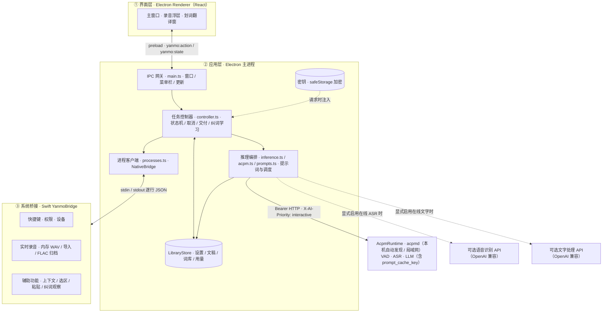

# 言墨 · Yanmo

**言语之间，自有笔墨。**

言墨是一款**支持中文、英文和中英混说的语音输入法**，适用于 Apple Silicon Mac。按 **FN** 开始说话，再按一次结束。言墨默认通过本机独立的 `AcpmRuntime`（`acpm-desktop`）服务执行语音识别（`qwen3-asr` / CPU VAD）与本地文字处理（`yanmo-correct-4b-cot`），也可按需切换为远程局域网 AcpmRuntime 或兼容 OpenAI 的在线 API，再将结果粘贴到当前输入框。

> Yanmo supports Chinese, English, and mixed Chinese–English dictation on Apple Silicon Macs. Press **FN** to start and stop recording. By default, speech recognition, VAD, and text polishing/translation run locally via AcpmRuntime (`acpm-desktop`), with optional remote AcpmRuntime or OpenAI-compatible online API overrides.


## 下载安装

- **Mac 桌面端**：从[下载页](https://happenmass.github.io/Yanmo/)或 [GitHub Releases](https://github.com/Happenmass/Yanmo/releases/latest) 下载 `Yanmo-1.0.1-mac-arm64.zip`，解压后把 `言墨.app` 拖入「应用程序」。要求 Apple Silicon、macOS 14+。从 0.4.5 或更早版本升级时，请完整退出旧版，再替换整个应用。
- **Android 输入法**：在 [android-v1.15.94-yanmo.19](https://github.com/Happenmass/Yanmo/releases/tag/android-v1.15.94-yanmo.19) 下载签名 APK（`arm64-v8a`，最低 Android 9），详情见 [言墨 Android 说明](android/README.md)。

从 0.4.6 起（Android 从 `yanmo.19` 起），可在「设置 → 软件更新」或言墨菜单中检查更新。确认后，言墨会下载并校验 GitHub 安装包（Mac 校验证书与 SHA-256，Android 校验 SHA-256 与同发布签名），完整退出后替换或调起系统安装器完成更新。正式版和 Mac 原生录音桥接均使用团队 ID `299DDXTQH5` 的 Developer ID Application 身份签名，安装包的 SHA-256 见对应版本的 GitHub Release。

## 运行依赖（`acpm-desktop` 与 `acpm`）

言墨软件本身不内置 Python 推理运行时或任何模型权重，本地推理与跨设备加密同步均由独立的 `acpm` 生态组件提供：

- **Mac 桌面端 → 依赖 [acpm-desktop（AcpmRuntime）](https://github.com/Happenmass/acpm-desktop)**（建议 `v0.1.0+`，面向 Apple Silicon / MLX）：
  - 启动并保持 `AcpmRuntime` 运行，在其中准备好语音识别模型（`qwen3-asr-1.7b` / `qwen3-asr-0.6b`）、CPU VAD（`speech-vad-pyannote`）与本地文字模型（`yanmo-correct-4b-cot`）。
  - 言墨默认通过 `~/Library/Application Support/acpm-desktop/runtime.json` 同机自动发现连接；也可在「设置 → AcpmRuntime 服务」配置局域网 `acpm.local` / 远程地址与 Bearer Token，或在「设置 → API 服务」为语音识别或文字处理单独开启兼容 OpenAI 的在线 API。
- **Android 端 → 依赖 [acpm（Android AI SDK）](https://github.com/Happenmass/acpm) 与 `acpm-desktop`**：
  - **本地端侧听写**依赖同签名的 `acpm` Android AI SDK（建议 `v0.1.2+`，支持高通 HTP 端侧 ASR 推理、热词/光标上下文提示及请求级失败诊断）；也支持连接局域网内的远程服务或开启在线文字 API。
  - **跨设备加密同步**依赖局域网内运行的 `acpm-desktop`（`AcpmRuntime`）提供的端到端盲密文同步仓节点（mDNS / NSD 自动发现）。

## 主要功能

- **1.0.1 实时流式 ASR 与无感收尾（Mac 与 Android）**：Mac 与 Android 端均支持热词与光标上下文直传的实时流式识别预览（已确认文本 + 临时候选态）、`stream/finish` 直接复用与松手合并直入「整理中」；Android 端新增「设置 → 软件更新」自动检查与校验升级。
- **1.0.0 架构解耦**：推理引擎与模型权重管理统一交由外部 `AcpmRuntime`（`acpm-desktop`），Mac 安装包体积大幅缩减，应用包内只包含 Electron 与 Swift 原生系统桥接。
- **自适应半流式 VAD + 链式上下文分段识别（Mac 与 Android 行为一致）**：采用零丢帧连续切分与非对称低底噪追踪（`< 2.5s → 1200ms`、`2.5–15s → 800ms`、`>= 15s → 400ms`、`24s` 单段上限，录音结束自动无条件收尾），前段转写自动串联为后续段上下文。关闭自然整理时，每识别完一段立即写入当前输入框；开启自然整理或语音翻译时，浮层 / 听写条实时展示最新转写并在结束时整段一次润色写入。
- **端到端加密跨设备同步（Mac ↔ Android）**：基于 `AcpmRuntime` 盲密文仓与 X25519 / Ed25519 / HLC 协议，支持二维码扫码配对、24 词恢复码还原、局域网 mDNS / NSD 自动发现、文稿与加密录音 / 截屏附件秒传与按需拉取、词库增量合并与删除墓碑传播，以及稀疏节能同步策略（默认累积 10 条本地变更或每日 22:00 定时全量同步，并在输入活跃期自动避让）。

- **中英文输入**按口述语言输出。中英混说时，目标是保留句中的中英文片段。若要将口述内容转成指定语言，使用口述翻译。
- 默认 **FN** 开始或结束语音输入，**FN + Shift** 口述翻译，**FN + 空格**划词翻译，**Esc** 取消。支持自定义多组快捷键和左右纯修饰键。纯修饰键组合全部松开时触发，参与打字或鼠标组合时不触发。更新默认值时保留已保存的自定义配置，设置中可逐项恢复默认。
- 静音的 200×36 pt 黑墨浮层，显示真实音量、计时、取消、完成及半流式实时预览；不抢走原输入框焦点。
- 默认通过 AcpmRuntime 执行可选 CPU VAD 预检（`speech-vad-pyannote`）与语音识别（`qwen3-asr-1.7b` / `qwen3-asr-0.6b`）。启用自动整理且文字处理可用（AcpmRuntime 本地文字模型或在线文字 API）时，结合可用上下文生成正文；关闭自动整理或文字处理不可用时，直接写入识别原文。自动整理可选自然整理、保留原话、即时消息或文档段落风格。
- 口述翻译直接执行识别 → 翻译 → 写入；划词翻译在可拖动的独立宣纸窗口显示，按普通窗口层级切换，不替换选区、不保存历史。
- 两种翻译分别保存目标语言和快捷键，支持英语、简体中文、日语、德语。
- Markdown 译文排版／源码、代码着色和代码复制；围栏代码与行内代码由程序保护，不执行 HTML 或加载远程图片。
- 统计首页、20 周落笔日历、文稿搜索／编辑／复制／导出、个人词库及误识别纠正。ASR 优先使用当前应用组和全局高频词，每次最多 64 词。[评测与分组规则](docs/qwen-hotword-capacity-2026-11-17.md)
- 导入 5 分钟以内的音频、麦克风选择、历史保留周期和登录启动。关闭主窗口后隐藏程序坞图标，仅保留菜单栏及快捷键；菜单栏图标左键打开主窗口，右键打开菜单，重新打开窗口时按偏好恢复程序坞图标。
- 录音与输入框可读性分离；可读正文只作上下文，读取失败仍正常录音。
- 正文生成后向当时前台应用的当前焦点粘贴一次，允许途中切换应用、窗口和光标。开启历史记录时保存文稿。导入音频的结果只在文稿页显示。
- 录音开始时向 AcpmRuntime 发送轻量模型与前缀缓存预热请求（`POST /v1/models/prewarm`），模型下载、加载与内存驻留策略统一由 AcpmRuntime 管理。

Electron 与 Swift 系统桥接均随应用包交付，不再内置 Python 推理运行时或模型权重。

## 模块图

桌面端采用 Electron + React，通过 Swift 系统桥接处理快捷键、录音、FLAC 归档、选区和跨应用写入。Electron 主进程直接构建提示词并调度外部 AcpmRuntime 或用户显式开启的在线 API。[查看当前完整模块图与源码入口](docs/architecture/current-modules.md) · [Mac 实现与验证](docs/electron-mac-2026-10-21.md)



界面只经 preload 调用主进程；应用层分别调用系统桥接与推理服务。文稿、压缩录音（由 `YanmoBridge` 转为 16 kHz 单声道 FLAC）及 LLM 用量由主进程统一提交 SQLite，跨应用写入由系统桥接完成。

## 构建与启动

使用环境：Apple Silicon、macOS 14+；构建需要 Node.js 24、npm、Xcode Command Line Tools。当前实测环境为 macOS 26.6.2 / arm64。

```bash
npm ci
npm run build
npm start
```

构建应用包：

```bash
npm run package:mac
open dist-electron/mac-arm64/言墨.app
```

本机开发包递增构建：`npm run package:mac:local -- <序号>`，产物位于 `dist-local/<基础版本>+local.<序号>/mac-arm64/`。应用包内不再携带 Python 运行时或模型权重。

## 权限与使用

首次录音由 macOS 请求麦克风权限。FN、纯修饰键与跨应用写入需要在「系统设置 → 隐私与安全性 → 辅助功能」中允许当前的言墨应用；设置页提供权限入口与重新检查。

按快捷键开始录音，正文生成后粘贴到当时的当前输入位置；期间可以切换应用、窗口、聊天或光标。输入框不可读时仍正常录音，只是不提供其正文作为上下文。结果同时保留为文稿；导入音频仅生成文稿。

划词翻译一次支持 4000 字以内的可复制文本。优先读取复制提供的 HTML 并转换为 Markdown，随后恢复剪贴板；无有效选区时不使用旧剪贴板。关闭译文窗口会清除本次原文与译文。

## 隐私、缓存与迁移

- 本机默认通过 `~/Library/Application Support/acpm-desktop/runtime.json` 发现运行中的 `AcpmRuntime`（验证 `pid` 存活后使用 `http_base_url` 与随机 `token`）。
- 仅在用户显式切换为「局域网 / 远程地址」或开启「API 服务」中的在线能力时，才向外部地址发送音频或文本；所有远程 Token 与在线 API Key 均通过 macOS Keychain（`safeStorage`）加密保存，Renderer 不接触密钥或音频文件路径。
- Electron 数据在 `~/Library/Application Support/Yanmo/electron/`；文件权限为 600，目录为 700，原子保存。
- SQLite `yanmo.db` 是文稿、压缩录音、截屏、词库和设置的唯一来源。旧版 OGG/Opus 与新版 FLAC 历史录音均可播放。
- 点击「落笔日历」的日期可查看文字模型用量和各应用发送字数。
- 测试可用 `YANMO_DATA_DIR` 指定隔离数据目录，用 `YANMO_ACPM_DATA_DIR` 指定隔离的 AcpmRuntime 发现目录。
- 开启“在本机保存新文稿”时，识别后的录音由 `YanmoBridge` 压缩为 16 kHz FLAC，随文稿保留；删除文稿或保留期清理同时删除其录音。
- 自然整理使用 [polish.txt](engine/polish.txt)，程序原样采用模型返回的正文。遇到空输出、截断、取消或运行失败时，已取得的识别原文可用于重试。

## 开发与验证

```bash
npm test
npm run typecheck
swift run YanmoChecks
swift run YanmoInputChecks
swift run YanmoShortcutChecks
swift run YanmoBridgeInputChecks
npm run test:desktop
```

不公开辅助功能输入控件的编辑器可用隔离窗口验证，需已有辅助功能授权：

```bash
swift build -c release --product YanmoBridge
node --import tsx scripts/check-opaque-input.mts
```

只检查某个已运行应用能否保留录音目标（不读正文、不粘贴）：`node --import tsx scripts/check-input-capture.mts <bundle-id>`。

## 许可证

项目代码使用 [MIT License](LICENSE)。模型权重与推理运行由用户独立部署的 AcpmRuntime 或所配置在线服务提供。
