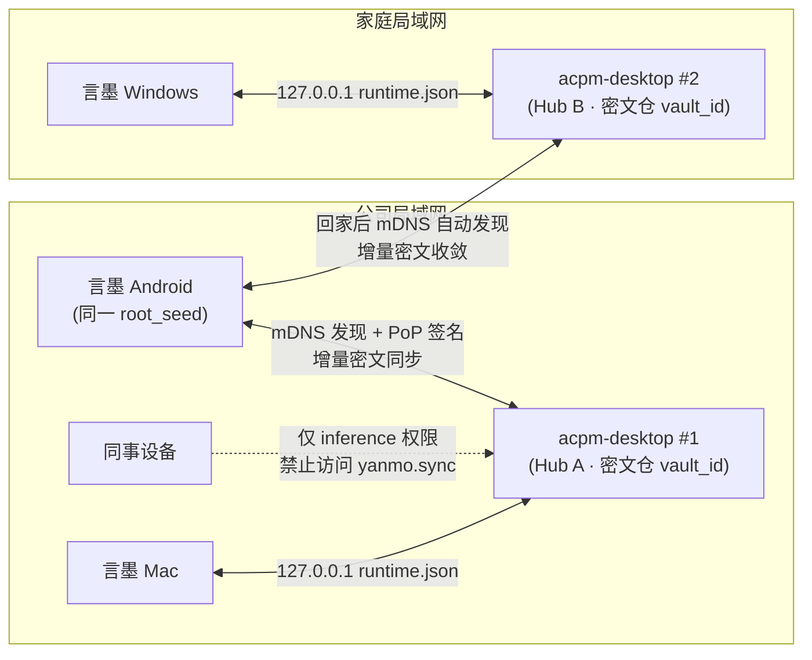
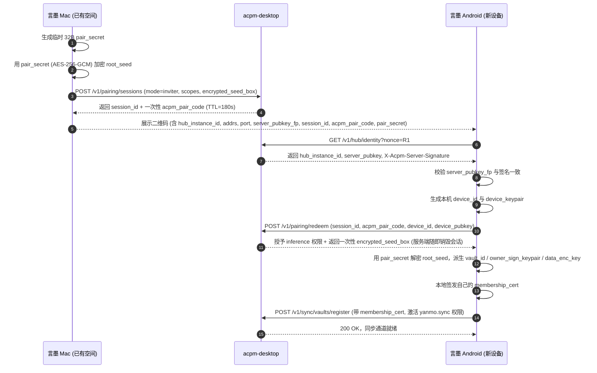

# 言墨 × AcpmRuntime 跨端加密同步与发现协议

版本：`v1.0-draft` · 日期：`2026-11-25` · 适用端：`acpm-desktop`（Mac / Win）、言墨桌面端（Mac / Win Electron）、言墨 Android 端。

上游参考：[当前模块图](current-modules.md) · [`acpm-desktop` 改造任务说明](acpm-desktop-sync-tasks.md) · [AcpmRuntime 客户端](../../desktop/acpm.ts) · [数据存储](../../desktop/store.ts) · [共享类型](../../desktop/shared.ts) · [热词规范](../../desktop/hotwords.ts)。

## 已确认的核心架构决策

1. **中心中转**：`acpm-desktop` 兼作局域网同步中转站（Sync Hub），手机与电脑无需同时在线即可完成同步。
2. **多 Hub 漫游**：支持同一用户在多台主机（如公司 Mac 与家里 Windows）各部署一个 `acpm-desktop`，移动设备在多 Hub 间漫游时自动收敛。
3. **零明文知识（E2EE）**：`acpm-desktop` 只保存言墨端加密后的密文与盲化索引，不持有解密密钥，不解析言墨业务结构。

---

## 1. 架构总览、拓扑与安全模型

### 1.1 多 Hub 漫游与权限隔离拓扑



### 1.2 职责边界

| 组件 | 负责内容 | 不负责 / 禁止内容 |
| --- | --- | --- |
| `acpm-desktop`（Hub） | 持久化 `hub_instance_id` 与服务端密钥对；mDNS（DNS-SD）广播；设备配对与 `scopes` 鉴权；按 `vault_id` 托管密文日志与大附件密文；按 `version_hlc` 做幂等比较并分配本 Hub 单调 `seq` | 绝不持有 `root_seed`、`owner_privkey`、`data_enc_key` 或 `key_mac_key`；不解析词库/文稿明文；不执行跨记录业务合并 |
| 言墨桌面端（Mac / Win） | 同机优先通过 `runtime.json` 连接本机 `acpm-desktop`；管理用户 `root_seed` 与设备密钥；发起/接收配对；在本地完成加解密、HLC 推进及词库/文稿合并 | 不把裸 `root_seed` 静态写入二维码或明文配置文件；不向未验证指纹的局域网节点发送同步请求 |
| 言墨 Android 端 | 通过 `NsdManager` 发现局域网 `_acpm._tcp.local.`；一次扫码接入推理与同步；在多个已配对 Hub 间漫游并充当多 Hub 状态搬运者 | 不要求与桌面端同时在线；不在非扫描期间长期持有系统组播锁 |

### 1.3 威胁模型

本协议在设计上覆盖以下安全与一致性威胁：

- **同局域网多用户**：公司或家庭 Wi-Fi 下存在多个人的 `acpm-desktop` 与多台言墨设备。通过 `hub_instance_id` + `server_pubkey_fp` 绑定机器，通过 `vault_id` + `data_enc_key` 隔离个人数据。
- **共享算力主机**：多人共用一台高性能 `acpm-desktop` 进行语音识别或文字整理。通过 `scopes` 将 `inference` 与 `yanmo.sync` 拆分；即使他人拥有 `inference` 权限，也无法读取任何 `vault_id` 密文，且无法解密落盘数据库。
- **mDNS 抢注与伪造节点**：恶意主机广播同名 `_acpm._tcp.local.`。客户端只信任与 `known_hubs` 中 `hub_instance_id` 和 `server_pubkey_fp` 同时匹配的节点，并在握手时校验服务端签名。
- **局域网 HTTP 抓包重放**：局域网默认走 HTTP 时，静态 Bearer Token 易被嗅探重放。配对后的局域网请求采用 Ed25519 请求签名（PoP）+ 时间窗 + Nonce 去重。
- **单设备丢失或被盗**：每台设备拥有独立 `device_id` 与密钥对，可在任一受信任端吊销丢失设备，阻断其继续拉推密文。
- **离线删除复活**：设备 A 离线期间设备 B 删除了某文稿/词条，设备 A 上线后不能把已删记录“写活”。通过软删除墓碑（tombstone）与 HLC 严格偏序解决。

---

## 2. 身份与密钥体系

不设中心化云账号，以 **个人空间根密钥（`root_seed`）** 定义「同一个人的个人空间」。

### 2.1 根密钥与恢复码

- **生成**：首次开启同步的言墨客户端使用密码学安全随机数生成器（CSPRNG）生成 32 字节 `root_seed`。
- **存储**：
  - macOS / Windows：通过 Electron `safeStorage` 存入系统钥匙串 / DPAPI（与当前 `acpmToken` 密钥保护机制一致）。
  - Android：存入 Android Keystore（AES/TEE 保护后的本地密文存储）。
- **可选恢复码（兜底机制）**：仅在用户所有已绑定设备全部丢失或重装时使用。将 `root_seed` 编码为带校验和的格式 `YM1-<Base32(root_seed || crc16)>`（不含连字符共 59 字符；实际展示每 4 位加 `-` 分组），不用于日常配对。

### 2.2 HKDF-SHA256 确定性派生

所有持有同一个 `root_seed` 的言墨客户端使用标准 `HKDF-SHA256`（`salt = UTF8("yanmo-sync-v1")`），派生以下 4 个互不串用的密钥与标识：

| 派生项 | `info` 参数 | 长度 | 格式 / 用途 | `acpm-desktop` 可见性 |
| --- | --- | --- | --- | --- |
| `vault_id` | `"vault-id"` | 16 B | 无填充小写 Base32（26 字符），作为密文仓与 REST 路径命名空间 | 可见（无个人明文语义） |
| `owner_sign_seed` | `"owner-sign-ed25519"` | 32 B | Ed25519 种子，生成 `owner_pubkey` / `owner_privkey`，用于签发设备归属证书 | 仅可见 `owner_pubkey` |
| `data_enc_key` | `"data-enc-aes256gcm"` | 32 B | AES-256-GCM 对称密钥，加密所有词库、文稿及大附件密文 | **永远不可见** |
| `key_mac_key` | `"record-key-hmac"` | 32 B | HMAC-SHA256 密钥，用于计算词库去重键与附件盲化 `blob_id` | **永远不可见** |

### 2.3 设备身份与归属证书

每台言墨客户端（Mac / Win / Android）首次初始化同步模块时各自生成：

- `device_id`：UUIDv4 字符串（小写连字符格式）。
- `device_keypair`：独立 Ed25519 密钥对（私钥同样存平台安全存储，永不导出离开本机）。
- `membership_cert`：由个人空间的 `owner_privkey` 对该设备的归属签名凭证，结构如下：

```json
{
  "version": 1,
  "vault_id": "m5x3k9q2r7t4v8w6y1z2a3b4c5",
  "device_id": "9f2b7d4e-1b2a-4c3d-9e8f-0123456789ab",
  "device_pubkey": "<base64url(32B Ed25519 pubkey)>",
  "platform": "android",
  "issued_at_ms": 1795584800000
}
```

签名方式：`owner_signature = Base64URL(Ed25519_Sign(owner_privkey, CanonicalJSON(payload)))`。其中 `CanonicalJSON` 按键名 UTF-8 字典序排列、无多余空格。

`acpm-desktop` 注册或校验跨端同步设备时，除核对配对状态外，**必须使用该 `vault_id` 绑定的 `owner_pubkey` 验证 `membership_cert` 签名有效**，确保同一个人空间内的成员资格无法被恶意 Hub 管理员或未授权设备伪造。

### 2.4 Hub 身份与权限解耦（`scopes`）

每台 `acpm-desktop` 首次启动时生成并持久化：

- `hub_instance_id`：UUIDv4。
- `server_keypair`：Ed25519 密钥对，用于响应签名防中间人。
- `server_pubkey_fp`：`hex_lower(SHA256(server_pubkey_raw))[0..16]`（16 位十六进制指纹，64 bit，用于 mDNS TXT 与二维码校验）。

`acpm-desktop` 对每个已配对设备维护独立的权限集合 `scopes`：

- `inference`：允许调用 `/v1/models`、`/v1/models/prewarm`、`/v1/audio/vad`、`/v1/audio/transcriptions`、`/v1/chat/completions`。
- `yanmo.sync`：允许读写指定 `vault_id` 下的 `/v1/sync/vaults/{vault_id}/*` 接口。

> 共享算力时（如同事或家人连接本机跑推理），仅授予 `["inference"]`，`vault_id` 置空；本人设备默认同时授予 `["inference", "yanmo.sync"]`。

---

## 3. 设备配对与归属交接流程

### 3.1 首台电脑初始化（本机自动绑定）

当用户在首台电脑（如公司 Mac）的言墨桌面端首次点击「开启跨端同步」时：

1. 言墨通过本机 `runtime.json`（`0600` 权限 + Bearer Token）连接本机 `acpm-desktop`。
2. 言墨生成 `root_seed` 与本机 `device_id`、`device_keypair`，派生 `vault_id`、`owner_pubkey` 及 `membership_cert`。
3. 言墨通过本地通道调用 `POST /v1/sync/vaults/register`：
   - 向 `acpm-desktop` 登记 `vault_id` 与 `owner_pubkey`；
   - 将当前桌面端注册为已配对设备，直接授予 `["inference", "yanmo.sync"]`。
4. 言墨将本机 `acpm-desktop` 的 `hub_instance_id` 与 `server_pubkey_fp` 写入 `known_hubs`，随后把本地已有词库与文稿加密推送到 Hub。

### 3.2 扫码配对（一次扫码 = 推理 + 同步全部打通）

严禁将裸 `root_seed` 静态放入二维码（避免截屏或他人偷拍导致永久泄露）。所有跨端密钥传递均通过 **`acpm-desktop` 内存一次性加密信箱** 完成：



#### 二维码载荷规范（`yanmo-pair://v1?...` 或紧凑 JSON）

```json
{
  "v": 1,
  "mode": "invite",
  "hub_id": "3c8e2a10-4b5d-4f6a-9c8d-1234567890ab",
  "fp": "9f4a1c8e2b7d0341",
  "addrs": ["192.168.1.24", "acpm-mac.local"],
  "port": 18790,
  "sid": "pair_01J...",
  "code": "83920417",
  "sec": "<base64url(32B pair_secret)>"
}
```

- `code`（`acpm_pair_code`）：服务端生成的单次高熵配对码，**180 秒过期，连续输错 5 次立即作废会话**。
- `sec`（`pair_secret`）：仅在屏幕二维码中出现，180 秒后会话销毁即不可再用；即便被拦截，没有 `acpm_pair_code` 也无法取出信箱。

### 3.3 第二台电脑加入（多 Hub 场景，如家里 Windows）

当用户已在手机或 Mac 拥有空间，现在想在家里 Windows 新装的 `acpm-desktop` #2 和言墨 Win 上打通同一个空间时：

1. **言墨 Win 初始化本地连接**：言墨 Win 通过本机 `runtime.json` 连上 `acpm-desktop` #2，选择「加入已有个人空间」。
2. **反向扫码（推荐路径，由已有手机扫码）**：
   - 言墨 Win 向 `acpm-desktop` #2 创建 `mode="join_wait"` 的配对会话，屏幕展示二维码（含 `Hub #2` 的 `hub_id`、`fp`、`addrs`、`port`、`sid`、`code`，以及 Win 端临时 **X25519 公钥** `win_eph_pubkey`）。
   - 言墨 Android 扫码后：
     1. 校验 `Hub #2` 的 `server_pubkey_fp`，用 `code` 将 Android 自己注册到 `Hub #2` 的可信设备表（`scopes: ["inference", "yanmo.sync"]`），并把 `Hub #2` 加入手机本地 `known_hubs`。
     2. 手机生成临时 X25519 密钥对，与 `win_eph_pubkey` 协商共享密钥，把 `root_seed` 加密写入 `Hub #2` 的信箱。
     3. 手机若已在本地缓存最新同步记录，立即向 `Hub #2` 推送或拉取增量密文。
   - 言墨 Win 轮询 `Hub #2` 拿到密文，解出 `root_seed` 后：
     - 用本地 `runtime.json` 通道在 `Hub #2` 注册 `vault_id` 与 Win 的 `membership_cert`；
     - 从 `Hub #2` 拉取并解密全量词库与历史。
3. **无手机时的电脑间直配（Mac ↔ Win）**：
   - 同局域网两台电脑互相添加时，可采用 **6 位一次性数字码 + SPAKE2（PAKE）** 在 `acpm-desktop` 配对信箱上完成对称密钥协商，再加密传递 `root_seed`，防止局域网明文 HTTP 窃听。
4. **全设备丢失兜底**：
   - 用户输入 `YM1-...` 恢复码直接还原 `root_seed`，在新 `acpm-desktop` 上通过本机 `runtime.json` 重建 `vault_id` 并同步。

---

## 4. mDNS 服务发现与 PoP 鉴权

### 4.1 DNS-SD 广播规范

`acpm-desktop` 不再依赖写死主机名 `acpm.local`（局域网多设备时会冲突变为 `acpm-2.local`），统一使用标准 **DNS-SD**：

- **服务类型**：`_acpm._tcp.local.`
- **实例名称**：`acpm-<hostname>-<hub_id前4位>`（如 `acpm-macstudio-3c8e`）
- **端口**：实际 HTTP 监听端口（默认 `18790`）
- **TXT 记录**（总长度控制在 200 字节内，**禁止出现用户名、`vault_id`、Token 或任何密钥**）：

| Key | 示例值 | 说明 |
| --- | --- | --- |
| `v` | `1` | 协议版本 |
| `id` | `3c8e2a10-4b5d-4f6a-9c8d-1234567890ab` | `hub_instance_id` |
| `fp` | `9f4a1c8e2b7d0341` | `server_pubkey_fp`（16 位 hex） |
| `sync` | `1` | `1` 表示开启密文同步仓，缺失或 `0` 表示仅推理 |
| `api` | `/v1` | API 基础前缀 |

### 4.2 多端发现与路由规则

1. **同机优先**：言墨 Mac / Win 启动及执行任务时，仍优先读取 `runtime.json`（参考 [acpm.ts](../../desktop/acpm.ts#L121-L158)），走本机回环地址与本机 Bearer Token；同机不走 mDNS。
2. **局域网自动匹配**：移动设备或远程桌面端监听 `_acpm._tcp.local.`，仅自动连接满足 **`id` 与 `fp` 同时命中本地 `known_hubs`** 的实例；未在 `known_hubs` 中的局域网节点（如同事的 `acpm-desktop`）直接忽略，不发起同步或推理请求。
3. **跨网段扩展地址**：支持用户为某个已绑定的 `hub_instance_id` 手动补充远程直连地址（如 Tailscale 内网 IP 或反向代理 HTTPS 域名，沿用 [shared.ts](../../desktop/shared.ts#L162-L171) 的 URL 校验规则）。当 mDNS 未发现该 Hub 时，允许回退到已保存的静态地址并继续校验同一套 `server_pubkey_fp` 与 PoP 签名。
4. **平台实现约束**：
   - **macOS**：Swift 系统模块或原生 Bonjour（`NWBrowser` / `NSNetServiceBrowser`）发现后同步给主进程。
   - **Windows**：Win32 DNS-SD API（`DnsServiceBrowse` / `mdns` 兼容库）。
   - **Android**：`NsdManager` 发现 `_acpm._tcp.`；仅在主动触发或前后台切换扫描窗口（如 8–10 秒）申请 `WifiManager.MulticastLock`，解析完成后立即释放以控制功耗。

### 4.3 PoP（Proof-of-Possession）请求与响应签名

在局域网明文 HTTP 场景下，为防止静态 Bearer Token 被同网段抓包重放，所有已配对设备发往 Hub 的**远程/同步 HTTP 请求**统一使用 Ed25519 请求签名：

#### 请求头
- `X-Acpm-Device`: `<device_id>`
- `X-Acpm-Timestamp`: `<Unix 毫秒时间戳字符串>`
- `X-Acpm-Nonce`: `<16B 随机 Base64URL>`
- `X-Acpm-Signature`: `<Base64URL(Ed25519_Sign(device_privkey, signing_string))>`

#### `signing_string` 构造规则（UTF-8 换行拼接）
```text
<METHOD_UPPER>\n
<PATH_AND_QUERY>\n
<hex_lower(SHA256(raw_request_body))>\n
<X-Acpm-Timestamp>\n
<X-Acpm-Nonce>
```
（无请求体时 `raw_request_body` 为空字节串，`sha256` 为 `e3b0c44298fc1c149afbf4c8996fb92427ae41e4649b934ca495991b7852b855`；`multipart/form-data` 文件上传场景对完整请求体哈希，或对 `content-sha256` 摘要校验。）

#### Hub 端验签规则
1. 根据 `X-Acpm-Device` 查询 `paired_devices`；设备不存在或 `revoked_at IS NOT NULL` 返回 `401 UNAUTHORIZED` / `403 FORBIDDEN`。
2. 校验请求路径所需 `scope`（推理接口需 `inference`，同步接口需 `yanmo.sync` 且路径 `vault_id` 必须等于设备绑定的 `vault_id`）。
3. 校验 `|server_now_ms - X-Acpm-Timestamp| <= 120000`（±120 秒）。
4. 在滑动时间窗缓存（TTL 150 秒）中检查 `(device_id, X-Acpm-Nonce)` 是否重复；重复则返回 `401` 防重放。
5. 用 `device_pubkey` 验签 `X-Acpm-Signature`。

#### 服务端防伪造响应签名
在 `/v1/hub/identity`、配对兑换及同步响应中，Hub 附加：
- `X-Acpm-Server-Timestamp`
- `X-Acpm-Server-Signature`：`Ed25519_Sign(server_privkey, "<client_nonce_or_req_id>\n<server_timestamp>\n<sha256_hex(response_body)>")`

> 向后兼容：本机言墨通过 `runtime.json` 访问 `127.0.0.1` 时，继续保留现有 `Authorization: Bearer <runtime_token>` 路径，保证已有推理调用链零回归。

---

## 5. `acpm-desktop` 盲密文仓存储与 HTTP API

### 5.1 Hub 侧 SQLite 表结构

```sql
CREATE TABLE paired_devices (
  device_id TEXT PRIMARY KEY,
  device_pubkey TEXT NOT NULL,
  device_name TEXT NOT NULL,
  platform TEXT NOT NULL,                 -- 'macos' | 'windows' | 'android'
  scopes_json TEXT NOT NULL,              -- e.g. '["inference","yanmo.sync"]'
  vault_id TEXT,                          -- 仅拥有 yanmo.sync 时非空
  owner_pubkey TEXT,                      -- 绑定该 vault 的空间公钥
  membership_cert_json TEXT,              -- owner_privkey 签发的成员凭证
  paired_at_ms INTEGER NOT NULL,
  last_seen_at_ms INTEGER,
  revoked_at_ms INTEGER                   -- 非空即吊销
);
CREATE INDEX idx_devices_vault ON paired_devices(vault_id);

CREATE TABLE sync_records (
  seq INTEGER PRIMARY KEY AUTOINCREMENT,  -- 本 Hub 局部单调自增游标
  vault_id TEXT NOT NULL,
  collection TEXT NOT NULL,               -- 'lexicon' | 'manuscript'
  record_key TEXT NOT NULL,               -- UUID 或 HMAC-SHA256 盲化键
  version_hlc TEXT NOT NULL,              -- 零填充混合逻辑时钟字符串
  origin_device_id TEXT NOT NULL,
  deleted INTEGER NOT NULL DEFAULT 0,     -- 0 | 1 (tombstone)
  ciphertext BLOB NOT NULL,               -- 密文信封（见 5.2）
  updated_at_ms INTEGER NOT NULL,
  UNIQUE(vault_id, collection, record_key)
);
CREATE INDEX idx_sync_vault_seq ON sync_records(vault_id, seq);

CREATE TABLE sync_blobs (
  vault_id TEXT NOT NULL,
  blob_id TEXT NOT NULL,                  -- hex(HMAC-SHA256(key_mac_key, "blob:" || plaintext_sha256))
  size_bytes INTEGER NOT NULL,
  ciphertext BLOB NOT NULL,               -- 加密后的 FLAC / 截屏字节流
  created_at_ms INTEGER NOT NULL,
  PRIMARY KEY (vault_id, blob_id)
);
```

### 5.2 密文信封格式（AES-256-GCM）

所有 `sync_records.ciphertext` 与 `sync_blobs.ciphertext` 统一采用以下二进制格式（JSON 传输时整体 Base64URL 编码）：

```text
[1 byte: envelope_version = 0x01]
[1 byte: flags]              -- bit0: 1 表示明文先经 gzip 压缩
[12 bytes: nonce]            -- 每次加密随机生成的 96-bit CSPRNG Nonce
[N bytes: aes_gcm_output]    -- AES-256-GCM 密文
[16 bytes: gcm_tag]          -- 128-bit 认证标签
```

**AAD（Additional Authenticated Data）绑定规则**：
- 业务记录：UTF-8 字符串 `yanmo-sync-v1|${vault_id}|${collection}|${record_key}|${version_hlc}|${deleted}|${origin_device_id}`
- 大附件 Blob：UTF-8 字符串 `yanmo-blob-v1|${vault_id}|${blob_id}`

> 将 `version_hlc`、`record_key`、`deleted` 和 `origin_device_id` 全部绑定进 AAD，可防止 Hub 或网络攻击者把旧密文替换到新版本号上，或篡改删除标记与来源设备。

### 5.3 HTTP API 规范

错误响应格式沿用现有 `AcpmError` 结构（见 [acpm.ts](../../desktop/acpm.ts#L280-L294)）：

```json
{
  "error": {
    "code": "CONFLICT_STALE_HLC",
    "message": "记录版本低于当前服务端版本",
    "request_id": "req_...",
    "stage": "SYNC_ADMISSION",
    "detail": "STALE_VERSION",
    "retryable": false
  }
}
```

#### 1) `GET /v1/hub/identity?nonce=<16B_base64url>`（免鉴权）
- 用途：新设备配对前或 mDNS 重连时验证目标机器确实持有对应的 `server_privkey`。
- 响应：`{ "hub_instance_id": "...", "server_pubkey": "...", "server_pubkey_fp": "...", "capabilities": ["inference", "yanmo.sync"], "sync_protocol_version": 1 }` + `X-Acpm-Server-Signature` 头。

#### 2) `POST /v1/sync/vaults/register`（本机 `runtime.json` Token 或已绑定有效 `membership_cert`）
- 请求：
```json
{
  "vault_id": "m5x3k9q2r7t4v8w6y1z2a3b4c5",
  "owner_pubkey": "<base64url>",
  "device_id": "9f2b7d4e-...",
  "device_pubkey": "<base64url>",
  "device_name": "Gu的 MacBook Pro",
  "platform": "macos",
  "membership_cert": { "...": "..." }
}
```
- 规则：校验 `vault_id` 尚无其他不匹配的 `owner_pubkey`（防止抢注），验签 `membership_cert` 后注册或激活设备的 `yanmo.sync` 权限。

#### 3) `POST /v1/pairing/sessions`（发起配对会话）
- `mode = "inviter"`（Mac/Win 邀请手机）：需本地 Token 或已授权 PoP；提交 `scopes`、`vault_id` 和用 `pair_secret` 加密后的 `encrypted_seed_box`（Base64）。
- `mode = "join_wait"`（新电脑等待手机扫码加入）：需本地 Token；提交 `win_eph_pubkey`。
- 响应：`{ "session_id": "...", "acpm_pair_code": "83920417", "expires_at_ms": 1795584980000 }`。

#### 4) `POST /v1/pairing/redeem`（兑换/投递配对会话，免现有设备 PoP，凭 `acpm_pair_code` 鉴权）
- `inviter` 会话兑换：新设备提交 `{ session_id, acpm_pair_code, device_id, device_pubkey, device_name, platform }`；Hub 核验一次性 `acpm_pair_code` 后写入 `paired_devices`（先授予 `["inference"]`，`yanmo.sync` 在客户端解密出 `root_seed` 并提交 `membership_cert` 到 `/v1/sync/vaults/register` 后激活），并返回 `encrypted_seed_box`，随即销毁内存会话。
- `join_wait` 会话分两步：`GET /v1/pairing/sessions/{session_id}`（带 `acpm_pair_code`）拿新电脑的 `win_eph_pubkey` 并注册手机设备；手机提交 `POST /v1/pairing/redeem` 上传密文信箱；新电脑经本机通道取回信箱后销毁。

#### 5) `GET /v1/sync/vaults/{vault_id}/changes?since_seq=0&limit=200`（PoP + `yanmo.sync`）
- 按 `seq > since_seq` 升序返回记录（`limit` 上限 500）：
```json
{
  "hub_instance_id": "3c8e2a10-...",
  "latest_seq": 412,
  "has_more": false,
  "changes": [
    {
      "seq": 410,
      "collection": "lexicon",
      "record_key": "8b7f...c210",
      "version_hlc": "001795584812345-0001-9f2b7d4e-1b2a-4c3d-9e8f-0123456789ab",
      "origin_device_id": "9f2b7d4e-1b2a-4c3d-9e8f-0123456789ab",
      "deleted": false,
      "ciphertext": "<base64url>",
      "updated_at_ms": 1795584812500
    }
  ]
}
```

#### 6) `POST /v1/sync/vaults/{vault_id}/changes`（PoP + `yanmo.sync`，单批上限 200 条）
- 请求体：`{ "changes": [ { "collection", "record_key", "version_hlc", "origin_device_id", "deleted", "ciphertext" } ] }`
- **Hub 事务幂等入库规则（防止多 Hub 同步乒乓死循环的核心）**：
  - 对每条记录查询当前 `(vault_id, collection, record_key)` 的 `existing.version_hlc`；
  - 若不存在，插入新行并分配新 `seq`，结果记为 `applied`；
  - 若存在且 **`incoming.version_hlc > existing.version_hlc`**（按 ASCII 字节字典序比较），覆盖更新并分配新 `seq`，结果记为 `applied`；
  - 若 `incoming.version_hlc <= existing.version_hlc`，**不做任何写入、不递增 `seq`**，结果分别记为 `noop`（相等）或 `stale`（较旧，附带服务端当前 `version_hlc` 供客户端检查）。
- 响应：`{ "latest_seq": 415, "results": [ { "collection": "...", "record_key": "...", "status": "applied", "seq": 415 } ] }`。

#### 7) `HEAD / PUT / GET /v1/sync/vaults/{vault_id}/blobs/{blob_id}`（PoP + `yanmo.sync`）
- `HEAD`：检查 `blob_id` 是否已存在，存在则跳过上传实现秒传。
- `PUT`：`Content-Type: application/octet-stream`，幂等写入加密后的音频/截图流。
- `GET`：按需下载指定加密附件流（支持 `Range` 头可选扩展）。

#### 8) 设备管理接口
- `GET /v1/devices`：列出当前用户可见的已配对设备列表（含 `device_id`, `device_name`, `platform`, `scopes`, `paired_at_ms`, `last_seen_at_ms`, `revoked_at_ms`）。
- `PATCH /v1/devices/{device_id}`：修改 `device_name` 或调整 `scopes`（仅本机通道或持有效 `owner_signature` 的设备可调用）。
- `DELETE /v1/devices/{device_id}`：设置 `revoked_at_ms = now`，立即吊销该设备的推理与同步权限。

---

## 6. 言墨客户端数据模型、HLC 与合并规则

### 6.1 混合逻辑时钟（HLC）规范

所有言墨端生成相同的定长 ASCII 字符串，保证直接按字符串字典序比较即为全序：

```text
<14位UTC毫秒,不足前补0>-<4位小写hex计数器>-<device_id(36字符)>
示例: 01795584812345-000a-9f2b7d4e-1b2a-4c3d-9e8f-0123456789ab
```

> 说明：2026 年毫秒时间戳约为 `1.79e12`（13 位），补齐至 14 位（如 `01795584812345`）可确保到公元 5138 年前长度恒定为 14 位。

**本地推进规则**：
- 本地产生写操作时：`pt = Date.now()`；`l' = max(last_l, pt)`；若 `l' == last_l` 则 `c' = last_c + 1`，否则 `c' = 0`。
- 收到远端记录 `msg_hlc = (msg_l, msg_c)` 时：
  - 若 `msg_l - Date.now() > 300_000`（远端设备系统时间快于本机 5 分钟以上），记日志告警且本地时钟推进上限限制为 `Date.now() + 300_000`，防止错误系统时间永久锁死写入；
  - 正常情况更新本地 HLC 状态为 `l' = max(last_l, msg_l, Date.now())`，按标准 HLC 规则重置或递增 `c'`。

### 6.2 多 Hub 同步状态机（如何保证公司 Hub 与家里 Hub 收敛）

言墨在本地对**每个已绑定的 Hub 单独维护游标**（`sync_hubs.last_pulled_seq`），单轮同步流程固定为：

1. **Pull**：从当前可连通的 Hub 拉取 `since_seq = hub.last_pulled_seq`。
2. **Decrypt & Merge**：
   - 按 `vault_id`、`collection`、`record_key`、`version_hlc`、`deleted` 组装 AAD 并用 `data_enc_key` 解密；
   - 将变更合并入本地 SQLite；凡被合并采纳且来自远端的新版本，若该版本尚未推送到**其他 Hub**，保留其 `version_hlc` 标记为待推送（`dirty`）。
3. **Push**：将本地所有 `dirty` 记录（含本机新产生的编辑，以及从 Hub #1 拉回但尚未推给 Hub #2 的记录）按批推送到当前 Hub。
   - 若记录在当前 Hub 返回 `applied` 或 `noop`（说明 Hub 已有相同 `version_hlc`），清除该记录针对当前 `hub_instance_id` 的待推送标记；
   - 若 Hub 返回 `stale`，表示有更新版本，立即重新执行一次 `Pull` 收敛。

> **为什么不会无限回环**：记录保留原始 `version_hlc` 与 `origin_device_id`。当手机把 Mac 在 Hub #1 写的记录（`HLC_1`）同步到家里 Hub #2 时，Hub #2 写入 `HLC_1`；随后家里 Win 拉取到 `HLC_1`，Win 不会给它换发新 HLC，下次手机再连回 Hub #1 时即使重推 `HLC_1`，Hub #1 也会因 `incoming == existing` 直接返回 `noop`，游标不动、流量归零。

### 6.3 词库（`lexicon`）加密载荷与语义合并规则

对齐现有 [hotwords.ts](../../desktop/hotwords.ts) 与 [shared.ts](../../desktop/shared.ts#L43-L49)：

- **盲化去重键（`record_key`）**：
  `record_key = hex_lower(HMAC-SHA256(key_mac_key, "term:" || termGroup(entry.group) || ":" || termKey(entry.term)))`
  其中 `termGroup(entry.group)` 将未分组规范为 `"global"`，`termKey(text)` 与 [hotwords.ts](../../desktop/hotwords.ts#L11-L13) 完全一致：`text.normalize('NFKC').trim().replace(/\s+/gu, ' ').toLowerCase()`。
  > 效果：不同应用分组下的同名热词相互独立；同一分组内用户在 Mac 和 Android 上各自手动添加的词条会自动映射到同一条 `record_key` 合并，不会出现重复词条。

- **明文 JSON 结构（`schema_version: 1`）**：
```json
{
  "schema_version": 1,
  "local_id": "uuid",
  "term": "AcpmRuntime",
  "hint": "本地推理与中转服务",
  "aliases": ["acpm runtime", "ACPM"],
  "removed_aliases": ["acmp"],
  "group": "ai_tools",
  "device_counts": {
    "mac-device-uuid": 18,
    "android-device-uuid": 7
  },
  "intent_hlc": "01795584812345-000a-mac-device-uuid",
  "last_matched_at_ms": 1795584800000,
  "created_at_ms": 1795000000000,
  "position_hint": 3
}
```

- **字段合并规则**：
  - `term`（保留用户最新大小写）、`hint`、`group`（取 `TERM_GROUPS` 枚举或 `null`）：按 `intent_hlc` LWW（Last-Write-Wins）；仅统计计数更新（`device_counts` / `matchCount`）不推进 `intent_hlc`，确保单纯计数增长不会复活已被其他设备删除的词条。
  - `aliases` 与 `removed_aliases`：双集合合并（`aliases` 取并集减去 `removed_aliases`；若同一别名再次被用户手动加回，从 `removed_aliases` 移除并提高 `intent_hlc`）。
  - `device_counts`（CRDT P-Counter）：按 `device_id` 逐键取 `max(local_count, remote_count)`；界面与 [hotwords.ts](../../desktop/hotwords.ts#L15-L19) 排序使用的 `matchCount = sum(Object.values(device_counts))`。彻底避免多端并发识别时丢计数。
  - `last_matched_at_ms`：取 `max`；`created_at_ms`：取 `min`。
  - **词条改名**：在客户端拆分为「旧 `record_key` 写入 `deleted=true` 墓碑」+「新 `record_key` 写入新词条」。
  - **删除与重加**：删除写入 `deleted=true` 的墓碑并更新 `version_hlc`；若此后用户在任意端重新添加同名同组词条，以更高 `intent_hlc` 写入 `deleted=false` 即可覆盖恢复。

### 6.4 文稿历史（`manuscripts`）加密载荷与合并规则

对齐现有 [store.ts](../../desktop/store.ts#L34-L48) 与 [shared.ts](../../desktop/shared.ts#L38)：

- **同步键**：`record_key = manuscript.id`（UUIDv4）。
- **明文 JSON 结构（`schema_version: 1`）**：
```json
{
  "schema_version": 1,
  "id": "manuscript-uuid",
  "date": 817364000.5,
  "occurred_at": "2026-11-25T05:33:20.500Z",
  "recording_ended_at_ms": 1795584800500,
  "seconds": 6.4,
  "application": "微信",
  "original": "原始识别文本",
  "asr_results": [
    { "engine_name": "qwen3-asr-1.7b", "transcript": "...", "language": "Chinese", "language_source": "detected" }
  ],
  "text": "整理后的最终正文",
  "polished": true,
  "user_edited": false,
  "delivery_note": null,
  "audio_warning": null,
  "source_device_id": "9f2b7d4e-...",
  "audio_blob": {
    "blob_id": "hex(HMAC(key_mac_key, 'blob:' || sha256))",
    "format": "flac",
    "size_bytes": 48210
  },
  "screenshot_blob": null
}
```

- **字段合并规则**：
  - 文本元数据按 `version_hlc` LWW 收敛。
  - 删除文稿写入 `deleted=true` 的墓碑（`ciphertext` 中可仅保留最小空对象 `{ "schema_version": 1, "id": "..." }`），墓碑保留 **90 天**后允许本地与 Hub 清理；若离线超过 90 天才重新连网的设备收到新基线通知，可触发全量校验。
  - **本地保留期（`retention`）隔离原则**：设置页的「历史保留周期（1 / 7 / 30 / 365 天）」**只作用于本机本地清理**（本地释放存储空间），**绝不写入 `deleted=true` 同步墓碑**，避免一台设备设了“仅保留 7 天”连上 Wi-Fi 后误删其他设备上的永久历史。
  - **大附件（录音 FLAC / 截屏）分级同步**：文稿创建/编辑时正文元数据立即随增量同步；`audio_blob` 与 `screenshot_blob` 仅在用户点击播放/查看时按需从 Hub 拉取（`GET .../blobs/{blob_id}`），或在设置中显式开启「自动缓存跨端录音附件」后在 Wi-Fi 下后台上传/预取。

### 6.5 言墨 SQLite 增量迁移实现（[store.ts](../../desktop/store.ts) `SCHEMA_VERSION = 5`）

已随 Phase 2 落地至言墨桌面端 `SCHEMA_VERSION = 5`，在保留既有业务表结构与触发器契约的同时新增 5 张同步元数据表：

- `sync_state (key TEXT PRIMARY KEY, value TEXT NOT NULL)`：持久化本机 HLC 状态（`hlc_last_ms`, `hlc_counter`）及当前绑定的 `vault_id`（空间切换时自动清空旧同步游标与日志状态）。
- `sync_entries (collection, record_key, local_id, version_hlc, origin_device_id, deleted, deleted_at_ms, updated_at_ms, meta_json, PRIMARY KEY (collection, record_key))`：保存各记录的 `version_hlc`、`origin_device_id`、`deleted` 墓碑及 `meta_json`（词库分桶 `deviceCounts`、`removedAliases`、`intentHlc`、`positionHint`；文稿 `sourceDeviceId`、`audioBlob`、`screenshotBlob` 与未知字段透传）。
- `sync_hub_cursors (hub_instance_id TEXT PRIMARY KEY, last_pulled_seq INTEGER NOT NULL DEFAULT 0, last_sync_at_ms INTEGER)`：逐 Hub 持久化增量拉取游标。
- `sync_hub_acked (hub_instance_id, collection, record_key, acked_hlc, PRIMARY KEY (hub_instance_id, collection, record_key))`：按目标 Hub 记录已确认同步到的 `version_hlc`，用于多 Hub 差异投递而不产生回环。
- `sync_pruned (manuscript_id TEXT PRIMARY KEY, pruned_at_ms INTEGER NOT NULL, pruned_version_hlc TEXT)`：隔离记录本机因 `retention` 策略在本地删除的文稿，不向外传播 `deleted=true` 墓碑，也不因未更新旧版本反向重新下载。

---

## 7. 安全边界、设备吊销与版本兼容

1. **单设备吊销**：
   - 用户在任一已配对设备或 `acpm-desktop` 界面点击移除丢失设备时，向各可用 Hub 调用 `DELETE /v1/devices/{device_id}`。
   - **可选密钥轮换**：若设备因丢失/被盗被吊销且用户希望阻断其读取未来新数据，可发起一次个人空间密钥轮换（生成新 `root_seed_v2`，仅向当前仍在线的受信任设备通过加密信箱重分发，并将新密文迁移到新 `vault_id_v2`）。
2. **Hub 磁盘保护**：
   - `acpm-desktop` 的数据库权限应设为 `0600`（所属目录 `0700`）；即使整份数据库被拷贝，无 `data_enc_key` 也无法还原词条原文、文稿正文或录音内容。
3. **前向兼容**：
   - 所有密文 JSON 均带 `schema_version`；客户端遇到自身不认识的新增字段（如未来新增 `tags`）时，在内存与本地保留未知字段透传，编辑其他字段时不要把高版本字段抹除。
4. **隐私约定对齐**：
   - 严格遵守 [AGENTS.md](../../AGENTS.md)：只有用户明确开启同步或连接局域网/远程 `acpm-desktop` 时才产生网络通信；不上传明文数据至第三方云端，不将真实个人口述历史写入测试或仓库演示数据。

---

## 8. 分阶段实施路线与联调验收矩阵

### 8.1 实施路线

| 阶段 | 范围 | 产出与前提 |
| --- | --- | --- |
| **Phase 1：发现、配对与 PoP 鉴权** | `acpm-desktop` 实现 `_acpm._tcp.local.` DNS-SD 广播、`paired_devices` 分权、`/v1/hub/identity`、`/v1/pairing/*` 与 PoP 验签；言墨实现 `root_seed` 派生、本机自动绑定与扫码/配对码接入 | 本机原有 `runtime.json` 推理流程零破坏 |
| **Phase 2：词库 + 文稿正文双向同步** | `acpm-desktop` 落地 `sync_records` 幂等密文仓；言墨桌面端完成 `SCHEMA_VERSION` 迁移、HLC 与 `Pull/Merge/Push`；Android 端同步接入词库与历史列表 | 覆盖多 Hub 漫游收敛单元测试与模拟端到端验证 |
| **Phase 3：大附件按需同步与管理 UI** | 落地 `sync_blobs` 按需拉取/上传；桌面端与 Android 端增加「已配对设备 / 同步状态 / 恢复码」界面 | 桌面端新增界面须先按 [AGENTS.md](../../AGENTS.md) 走 `docs/design/` 视觉出图并经用户确认后再实现 |

### 8.2 跨端联调验收矩阵

| 用例编号 | 场景 | 预期结果 |
| --- | --- | --- |
| `SYNC-01` | Mac 开启同步并扫码绑定 Android | 手机一次性获得 `inference` + `yanmo.sync` 权限与 `root_seed`，桌面端词库与文稿解密一致 |
| `SYNC-02` | 多 Hub 漫游（Mac ↔ Hub #1 ↔ Android ↔ Hub #2 ↔ Win） | Android 在公司与家里切换 Wi-Fi 时自动通过 mDNS 切换 Hub，两端数据双向收敛，且不产生重复推送死循环 |
| `SYNC-03` | 盲密文验证 | 检查 `acpm-desktop` SQLite `sync_records` 与 `sync_blobs`，无任何词条原文、正文、应用名或明文音频头 |
| `SYNC-04` | 并发词库去重与分桶计数 | Mac 与 Android 离线各自添加 `"AcpmRuntime"` 并各自匹配 3 次、5 次；同步后合并为 1 条，`matchCount === 8` |
| `SYNC-05` | 离线删除不复活 | Mac 离线期间 Android 删除某文稿；Mac 上线同步后该文稿变为已删除状态，不会反向复活 |
| `SYNC-06` | 共享算力隔离 | 同事设备仅被授予 `inference` 权限；访问 `/v1/sync/vaults/{vault_id}/changes` 返回 `403 FORBIDDEN` |
| `SYNC-07` | 伪造 mDNS 与 PoP 重放 | 局域网伪造同服务名但 `fp` 不符的节点被客户端忽略；截获并重放同一 `X-Acpm-Nonce` 请求被 Hub 返回 `401` 拦截 |
| `SYNC-08` | 本地保留期隔离 | Android 设置保留 1 天并触发本地清理后，Mac 上的历史文稿保持完好，不会被删除 |
