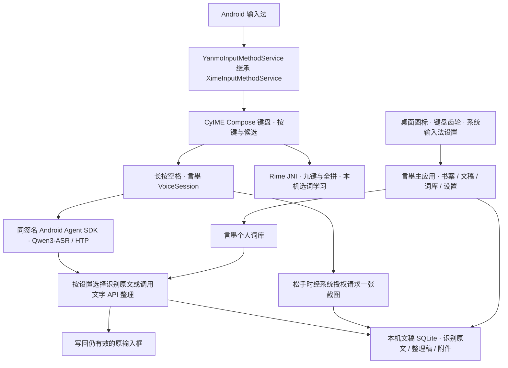

# 言墨 Android 现存架构与 CyIME 残留

2026-11-19 · 三个言墨入口共用主应用设置。九键和 26 键复用上游 Compose 输入核心、Rime JNI 及本机词库。听写独立走言墨的录音、SDK Binder、可选文字整理和上屏链路。

正式构建固定应用键盘和清理补丁。清理补丁移除了旧设置、手写、拍照识别、旧语音和字幕的入口、推理实现、模型目录、原生依赖及权限。插件宿主、Lua 运行时、Windows 同步初始化和默认模型下载也已退出言墨运行时。APK 仍带键盘所需的 Rime 与原生 ONNX 依赖。

## 当前产品链路

| 层 | 当前职责 |
| --- | --- |
| 主应用与设置 | `YanmoActivity` 持有四个标签。键盘齿轮和系统 `SettingsEntry` 都进这一个 Activity 的设置页。`YanmoSettings` 定义言墨自己的语音、文字和隐私配置，复用上游 Compose 分组、开关和主题组件。 |
| 常规键盘 | `YanmoInputMethodService` 继承上游整套输入法服务。按键和组合态、布局选择、中英切换、候选栏、Rime 词典与学习都走这一层。底部系统输入法切换由 Android 提供。表情、符号、编辑、剪贴板和无痕仍是键盘工具。 |
| 听写与上屏 | 九键和全键盘的长按空格都回调 `VoiceSession`。`LocalAsr` 通过同签名 Binder 把分窗 WAV 交给独立安装的 `dev.androidagent.sample`。Magic V6 上实际识别由 SDK 的 Qwen3-ASR / Qualcomm HTP 执行。文字结果只写回仍有效的原输入框。 |
| 文字整理和词库 | 显式启用时，`Polish` 将识别文字、应用包名和个人词条发给配置的文字 API，使用仓库的 `engine/polish.txt`。安卓手动词库供整理使用。键盘拼音候选的学习由 Rime 独立进行。安卓目前没有桌面端写入后按 Enter 提取纠词的链路。 |
| 存储与截图 | `Manuscripts` 管理 SQLite 文稿及分块附件，并迁移旧言墨文稿。已授权时，`ScreenCapture` 在结束口述时取一帧，单独保存。当前包使用 Android 单次截屏接口。 |

[主应用与路由](../../android/src/main/java/dev/yanmo/ime/YanmoActivity.java) · [设置](../../android/src/main/kotlin/dev/yanmo/ime/YanmoSettings.kt) · [输入法服务](../../android/src/main/java/dev/yanmo/ime/YanmoInputMethodService.java) · [听写](../../android/src/main/java/dev/yanmo/ime/VoiceSession.java) · [SDK 接线](../../android/src/main/java/dev/yanmo/ime/LocalAsr.java) · [截屏](../../android/src/main/java/dev/yanmo/ime/ScreenCapture.java) · [Android 实机与构建记录](../../android/README.md)

桌面端是独立进程链路。Electron 提供界面和控制层，Mac 的 Swift 桥负责系统键鼠与录音，Python 后端负责本地识别和文字处理。Android 与桌面共享产品约定和自然整理提示词。Android 不启动桌面的 Electron、Swift 或 Python 运行时。[桌面模块图与 Windows 分支边界](current-modules.md)

## 构建边界

正式构建固定检出 CyIME 1.15.94 的 `6f97a555ced063c0bcad73c600fe420f5e4b2536` 及子模块。构建脚本应用言墨的补丁，改写 Manifest、包名和资源，将言墨 Java、Kotlin 和提示词覆盖进上游 Gradle 工程，然后执行 Release 构建和 R8。默认包还从校验过的上游 full APK 提取九键词组模型。仓库里的 `android/src/main` 只覆盖言墨自己的部分，完整上游源码在单独的构建缓存里。上游和第三方许可证随项目及 APK 保留。[正式构建脚本](../../android/build-apk.sh) · [源码准备脚本](../../android/tools/prepare_source.py) · [键盘补丁](../../android/patches/yanmo-keyboard-ui.patch) · [清理补丁](../../android/patches/yanmo-legacy-cleanup.patch) · [构建时删除清单](../../android/patches/yanmo-unused-source.txt)

## yanmo.10 的交付边界

- 正式 APK 为 118.06 MiB，较 yanmo.7 减少 20.46 MiB。清单中保留言墨键盘、单帧截屏以及系统和库的必要组件。相机、短信、联系人、共享图片读取、旧推理服务和插件崩溃页已撤下。
- DEX 和 R8 映射核查未发现旧手写、OCR、语音、字幕、Lua 插件宿主及 Windows 剪贴板实现。APK 中保留 `librime_jni.so`、`libcylm.so`、`libonnxruntime.so` 和 `t9_ngram.lm`。
- 固定版本的上游检出用于复现构建。部分上游兼容类型随键盘源码编译，未到达的实现由 R8 裁剪。清理针对源码覆盖层及发布包，用户的 Rime 词库和文稿沿用原数据目录。

## yanmo.7 的残留审计（清理前）

| 模块 | 已收口的入口 | 当前留下的部分 |
| --- | --- | --- |
| 旧设置与更新 | 旧 `MainActivity` 及图标别名已取消注册。旧设置导航 `SettingsScreenKt` 被 R8 裁掉。上游安装包更新已禁用。 | 上游 Settings 源码仍在。DEX 还有 `MainActivity` 类壳和改指向言墨的插件跳转辅助代码。R8 清单显示旧 `onCreate` 和 `SettingsMainContent` 已裁掉。应用仍初始化旧更新器的安装来源检测，包内还有旧更新说明资源。 |
| 手写 | 工具栏入口移除，布局选择过滤手写方案。 | `InferenceService` 仍以非导出服务注册在 `:inference` 进程，服务代码保留手写 ONNX 推理。APK 仍含手写 JNI、模板与词表。启动仍调用 `DefaultModelInstaller`，其默认候选含 `ochwpro`。是否访问模型目录或下载取决于引导标记、已处理状态和网络条件。 |
| 拍照识别 | 拍照和剪贴板识别入口移除。OCR Activity、Service 及 `CAMERA` 权限已撤。 | DEX 中仍有 `OcrCameraPanelKt`、`OcrEngine` 和旧 OCR 组件的类定义。CameraX 依赖仍参与构建，Manifest 有其禁用的元数据服务。此包未带 OpenCV 的主 native 库 `libopencv_java4.so`，也没有找到 OCR 模型权重。 |
| 旧听写与字幕 | 旧 STT 状态强制关闭，注册表移除了上游 ASR 和字幕组件。 | DEX 仍有 `VoiceRecognitionHandler`、`AsrInferenceService`、`CallCaptionService` 等类定义，包内还有 Sherpa JNI。正式听写走独立 SDK，APK 未发现内置语音模型权重。 |
| 插件与跨设备剪贴板 | 键盘快捷工具过滤插件按钮，新设置未开放插件市场及同步配置。 | `XimeApplication` 启动时仍配置插件宿主，初始化 Windows 设备同步，安装资产中的 Windows 剪贴板插件并读取已启用插件。插件市场资源和 `plugin-core` 仍随包。安装或初始化不代表同步已开启，此项默认关闭。 |
| 图片剪贴板、短信与通讯录 | 新设置没有这些独立配置。键盘的剪贴板面板仍保留。 | `ImageAccessActivity` 和 `VerificationCodeSmsReceiver` 仍注册，输入法仍初始化剪贴板并调用通讯录建议同步；APK 声明媒体图片、短信和通讯录权限。短信功能默认关闭且需权限，通讯录需启用相应插件并授权。Magic V6 本次查询中三项权限均未授予。 |

应用更新后的 `PackageReplacedReceiver` 仍有普通键盘职责。它拉起应用进程，使 Rime 词库能在系统更新 APK 后提前准备。现有键盘还使用上游 `kime_settings` 和 Rime 用户数据。包内 `librime_jni.so` 与 `libcylm.so` 均动态链接 `libonnxruntime.so`，因此不能用整个 ONNX 库的体积估算移除手写和旧听写后的收益。

## 清理前的早期打包入口

`android/tools/package_apk.py` 是对上游二进制 APK 改写 Manifest、DEX 和资源的旧原型脚本。正式构建脚本未调用它。它仍将截屏写成 MediaProjection 前台服务，与当前 `ScreenCapture` 的 AccessibilityService 声明不匹配。

`SpaceHoldGesture`、`VoiceIndicator` 和 `src/upstream-stub` 留有旧覆盖层方案。正式构建固定 `SOURCE_HOOK=true`，使用源码中的 Compose 手势和浮层。当前 DEX 不含 `SpaceHoldGesture` 独立类定义，`VoiceIndicator` 类仍存在。[旧 APK 改写脚本](../../android/tools/package_apk.py) · [正式输入法服务](../../android/src/main/java/dev/yanmo/ime/YanmoInputMethodService.java)

## yanmo.7 的 APK 核查数据

下列数字采用 APK 内 ZIP 条目的压缩后大小。各项只是已核对的资源和库，不是可直接删除的体积估算。

| 项目 | 体积 |
| --- | ---: |
| 已签名 APK | 138.52 MiB |
| 九键词组模型 `t9_ngram.lm` | 63.55 MiB |
| `assets/handwriting/` 下 14 个文件 | 7.26 MiB |
| `libsherpa-onnx-jni.so` | 8.57 MiB |
| `libonnxruntime.so` | 10.08 MiB |
| 插件市场资产 20 个文件 | 0.15 MiB |

设备和本地正式签名包的 SHA-256 一致，为 `30a735622bc6d2649f29acbb0536939aee2c2b5153c1f269f3f7845bf950838c`。签名包的 DEX 与构建缓存里的 R8 Release DEX 逐字节一致。注册组件和权限按最终 Manifest 核对，类定义按实际 DEX 和 R8 映射交叉核对，原生库依赖按 ELF 动态链接表核对。类或资源随包只证明它存在。功能是否启动另看应用初始化、入口、权限及配置条件。
