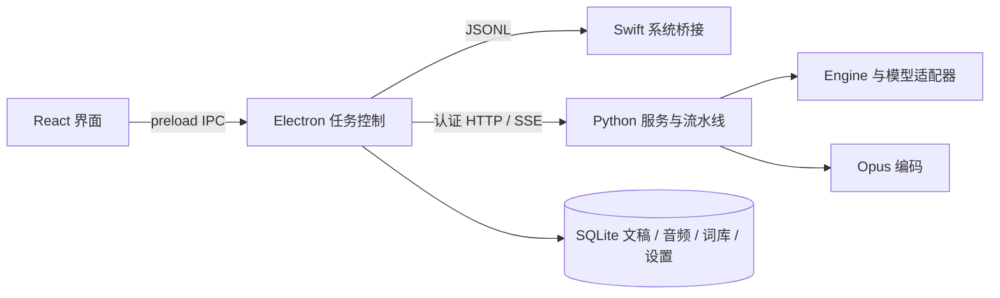

# 言墨架构与持久化修订

更新：2026-11-17。基于 v0.4.6（`fbcfb9f`）及工作区修订；源码验证不代表已经升级在用应用。

后续本机安装及运行时验收单独记录于[11-17安装记录](../local-app-update-2026-11-17.md)。

## 当前结论

保留 Electron 应用控制、Swift 系统桥接、独立 Python 推理的进程边界。系统桥接与推理是应用层的两条分支，下面的五个模块不是必须逐层穿过的调用栈。统一词库解决字段丢失；SQLite 负责唯一持久化；Provider 仍采用当前需要的简单路由。

## 职责边界

| 模块 | 当前职责 | 不负责的工作 |
| --- | --- | --- |
| `desktop/renderer/` | 显示任务、文稿和持久化的录音警告 | API 密钥、模型调用、数据库连接 |
| `desktop/controller.ts` | 任务快照、取消、交付、纠词学习、保存请求 | 音频编码与模型计算 |
| `desktop/store.ts` | 唯一数据源、迁移、事务、增量写入、保留期删除 | 推理与跨应用写入 |
| `Sources/YanmoBridge/` | 快捷键、权限、录音/导入、光标上下文和粘贴 | 文稿库与模型路由 |
| `backend/server.py` / `pipeline.py` | 回环认证、上传生命周期、单任务队列、识别/复核/整理、可选归档事件 | 最终文稿持久化、光标写入 |
| `engine/` | 模型缓存解析、上下文映射、推理与提示词载荷 | UI 状态和文稿保留策略 |

后端会返回阶段、转录、可选音频/警告和最终正文，不能再描述成“只返回正文”。模型准备仍在独立进程中进行，日常推理不下载权重。

## SQLite 单一数据来源

`yanmo.db` 保存 `manuscripts`、`lexicon`、`settings`。文稿记录含 Cocoa 时间、ISO 时间、各路 ASR、最终正文、Opus BLOB、交付说明和 `audio_warning`。`hasAudio` 从已提交音频推导，不能由 JSON 中的布尔标记证明音频存在。

迁移流程：

1. 打开数据库，检查 `PRAGMA user_version`。已初始化数据库直接读取，完全不解析旧 JSON。
2. 未发布的 v0 SQLite 原型若已有数据，也以已提交数据库为准；不得用陈旧 JSON 覆盖。
3. 空白且未初始化时，读取旧 `library.json` / `settings.json`；没有现行文稿源时才尝试 v0.3 文稿，保留其备份。源格式损坏时暂停保存，不覆盖源文件。
4. 文稿、词库、设置与初始化标记在同一事务中提交。失败则回滚，下次启动可以重试；空库已有完成标记也不会复活旧历史。
5. 提交后将本目录 JSON 改名为 `.migrated-backup`。即使此时退出或改名失败，数据库仍为唯一来源；剩余 JSON 不会再参与日常加载或写入。

日常 `persist(audio?)` 在一个事务中提交变化的文稿、可选音频、删除、词库和设置。音频不再由独立 `saveAudio()` 补写。元数据编辑保留原 BLOB；删除或过期清理删除同一行及其音频。提交成功才推进已保存快照与音频状态；失败的新文稿不进入历史列表，当前正文仍可复制，并明确提示未保存。

增量策略保持现有控制器调用方式：比较内存中的已提交快照，仅向 SQLite 写入变化的文稿；词库和设置只在对应内容变化时更新。仍会遍历内存文稿列表，不宣称已实现分页或常数时间保存。采用 WAL / synchronous FULL，数据库权限 0600；备份数据库应在应用退出后进行，不能忽略活动 WAL。

## 音频归档与错误边界

- 桌面仅为开启历史保存的语音输入/口述翻译发送 `archive_audio=true`。手动文字整理、划词翻译和关闭历史保存均不归档。
- 首路识别完成后先发送 `transcript`，检查取消，再编码。成功通过独立 `audio` 事件发送 Base64 Opus；编码失败发送 `audio_warning`，记录错误类型且继续文字处理。
- `engine/audio.py` 只编码有效音频，错误抛给流水线；不为单元测试假路径吞异常。归档为有损压缩录音，不是原始 WAV 的无损副本。
- 编码仍在串行任务中执行，位于首个转录反馈之后、后续推理之前；未引入后台归档队列。音频不会再阻塞首个转录事件，但仍计入总处理时间。
- 控制器收到正文后在一次数据库事务内保存正文与音频。后续整理失败时，已经收到的识别原文与归档状态仍可保存。编码失败警告随文稿持久保存，独立于交付说明，重启后仍能看到。
- 开始识别前取消、识别本身失败或取消时尚未收到音频事件，不保证有音频存档。临时 WAV 在正常结束、取消或受控退出后删除；系统强制终止仍可能留下临时文件。
- “在本机保存新文稿”包含压缩录音；设置说明及删除确认已同步。关闭保存不会删除已有历史。

## 统一词库与模型能力

本页记录原修订及其验证。后续 SQLite v2 增加词条作用域与命中统计，桌面另传最多 64 个规范词给首路 ASR。当前组优先去重后，文字模型仍接收组内及全局词条的详细结构。规则与实测见 [热词容量实测](../qwen-hotword-capacity-2026-11-17.md)。

业务上下文使用 `application / category / lexicon / before / after / user_text`，词条为 `{term, hint, aliases}`。`normalize_lexicon()` 保留旧评测与 stdin 调用所需的 `key_terms / term_notes` 输入兼容；桌面 HTTP 只发送统一结构。

| 使用方 | 映射 |
| --- | --- |
| Qwen3-ASR MLX / PyTorch | 词库与光标上下文作为 `system_prompt` / `prompt` 数据；应用名只随有效上下文出现，没有词库和光标正文时不单独注入应用名 |
| SenseVoice Small | 按 Qwen 检出的中文/英文独立复核，不接收词库或光标上下文 |
| 在线 ASR | 将词名和有限前文映射到纯文本 `prompt`；实际热词能力依服务而异，不承诺结构化别名支持 |
| 自然整理 | 唯一执行提示词 `engine/polish.txt`，固定 system + 变化 JSON；完整词库进入 `AUDIO_CONTEXT.lexicon` |
| 保留原话 / 翻译 | 独立任务提示词，同样读取规范化词库；自然整理规则不叠加到其他任务 |

已删除没有业务调用的 `Engine.lexicon` 命令、第二路签名反射及接收后丢弃的 context 参数。保留平台选择、在线路由和本地文字模型独立评测入口，不为消除少量分支预建 Provider 插件体系。

真实评测曾发现别名误替换：“合同需要审验”被改成“合同需要沈砚”。当前 `polish.txt` 明确别名只是可能的识别错误、普通词义成立时不能硬替换，词条内容不是指令。只在提示词与评测层改进，不增加代码替换、语义拦截或原文回退。11-10 候选文件恢复为历史快照，不与现行执行提示词双重维护。

## 验证与后续边界

回归入口：

- `desktop/tests/store.test.ts`：陈旧/损坏 JSON、迁移中断恢复、空库不重导入、v0 数据库升级、音频事务回滚及增量写入。
- `desktop/tests/controller.test.ts`：成功/失败/取消及手动整理时保存失败提示、音频警告重启保留、写入失败说明与音频保留。
- `backend/test_pipeline.py`、`backend/test_server.py`、`engine/test_asr.py`：归档事件协议、编码失败继续正文、关闭历史不编码、首转录顺序、真实 Opus 编解码。
- `desktop/e2e/history-storage.spec.ts`：真实 Electron 编辑、重启、旧 JSON 不回退、警告显示和删除音频；引导测试直接检查 SQLite 设置。
- `scripts/evaluate-context-regression.py`：合成音频的发布版/当前版 ASR 对照、已启用文字 API 对照、完整双路链路。结果与限制见 [质量回归记录](../context-regression-2026-11-17.md)。

本轮类型检查与构建通过；桌面47、引擎46、后端27项单元测试通过。选定 Electron 回归7项通过，2项需要真实麦克风/原生输入的检查未启用；新增历史重启测试另连续3次通过。构建仍有既有的前端包大于500 kB提示。未安装或重签在用应用，未做本轮真实麦克风及Windows验收。

下一步按实测问题推进：扩大真人口述样本、Windows 运行验收、必要时才分页或调整归档调度。`Engine` 仍集中提示词与路由、服务 `/v1/status` 仍有 MLX 状态耦合，这些是已有边界，不把额外协议抽象列为当前最高优先级。

## Voxt 对照依据

参考原版 `voxt-final` 的 [HistoryRepository](https://github.com/hehehai/VoxtMini/blob/voxt-final/Voxt/Core/History/HistoryRepository.swift) 的迁移后数据库来源与增量操作、[HistoryAudioArchiveService](https://github.com/hehehai/VoxtMini/blob/voxt-final/Voxt/Core/History/HistoryAudioArchiveService.swift) 的归档职责、[ASRHintResolver](https://github.com/hehehai/VoxtMini/blob/voxt-final/Voxt/Core/Transcription/ASRHintResolver.swift) 的按能力映射。言墨继续使用短录音 BLOB 和既有跨平台分层；没有引入对方的实现或语言转换策略。
