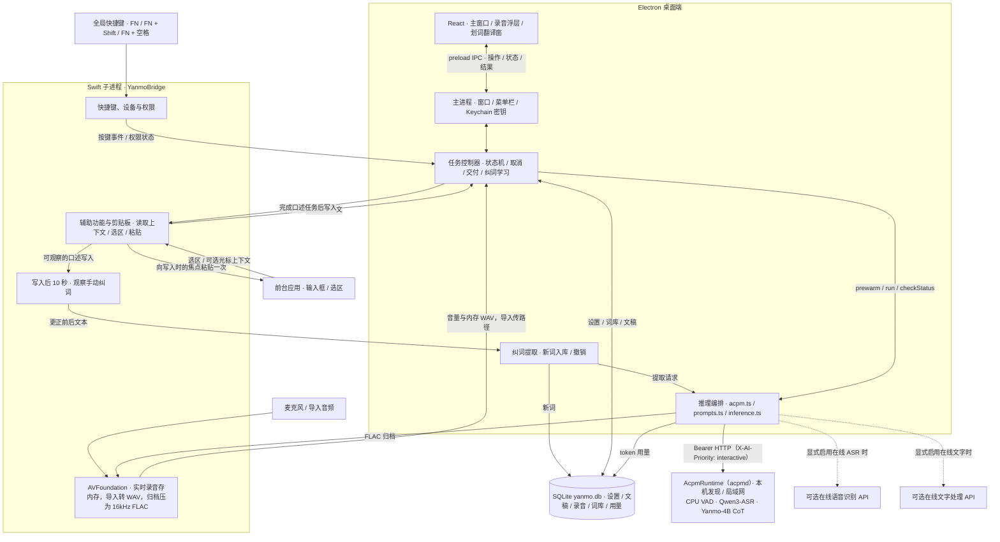

# 言墨当前模块图

2026-11-23 · Apple Silicon Mac 源码架构（推理能力已全面迁移至 AcpmRuntime）。

## 各入口如何交付结果

| 入口 | 推理路径 | 交付位置 |
| --- | --- | --- |
| **FN** 语音输入 | 默认经 AcpmRuntime（可选 CPU VAD + Qwen3-ASR）识别；开启自动整理且文字模型或在线文字 API 可用时，按选定风格整理。 | 粘贴到写入时的当前焦点。开启历史时保存正文、识别结果及 FLAC 录音。 |
| **FN + Shift** 口述翻译 | 识别 → 翻译到所选语言 | 粘贴到当前焦点。开启历史时保存译文与识别对照。 |
| **FN + 空格** 划词翻译 | 读取选区 → 翻译，保护 Markdown 中的代码 | 独立译文窗口。原选区保持原样，关闭窗口后清除原文和译文。 |
| 导入音频 | 规范化为 WAV 后，复用语音输入的识别与可选整理 | 文稿页。开启历史时写入文稿库。 |
| 手动整理文稿 | 使用已保存的识别原文或用户修订正文 → 整理 | 更新当前文稿。 |

## 源码入口

| 模块 | 职责与入口 |
| --- | --- |
| 界面与 IPC | [React 界面](../../desktop/renderer/App.tsx)包含书案、文稿、词库、设置、首次引导、录音浮层和划词翻译窗。[附件预览](../../desktop/renderer/ManuscriptAttachments.tsx)兼容 OGG/Opus 与 FLAC 录音播放。[Markdown 渲染](../../desktop/renderer/markdown.ts)负责译文排版。[preload](../../desktop/preload.ts)向界面提供操作和状态订阅。 |
| 桌面主进程 | [main.ts](../../desktop/main.ts)管理窗口、菜单栏、IPC、Keychain 密钥与自动更新。[controller.ts](../../desktop/controller.ts)管理任务状态、进度、取消、交付与纠词学习。[processes.ts](../../desktop/processes.ts)管理 Swift `YanmoBridge` 进程通信。 |
| AcpmRuntime 与推理编排 | [acpm.ts](../../desktop/acpm.ts)实现同机 `runtime.json` 发现、远程连接与 AcpmRuntime HTTP 客户端（`/v1/models`、`prewarm`、`vad`、`transcriptions`、`chat/completions`）。[prompts.ts](../../desktop/prompts.ts)加载 [polish.txt](../../engine/polish.txt)、[prompt.txt](../../engine/prompt.txt)、[correction-terms.txt](../../engine/correction-terms.txt) 并组装稳定前缀与 Markdown 代码保护。[inference.ts](../../desktop/inference.ts)统一调度 AcpmRuntime 与用户可选在线 API，记录无内容诊断与 token 用量。 |
| 系统桥接 | [YanmoBridge](../../Sources/YanmoBridge/main.swift)调用[快捷键监听](../../Sources/YanmoNative/HotKeys.swift)、[音频设备/录音/FLAC 归档](../../Sources/YanmoNative/AudioInput.swift)及[系统集成](../../Sources/YanmoNative/SystemIntegration.swift)。 |
| 数据与统计 | [LibraryStore](../../desktop/store.ts)以 SQLite `yanmo.db` 为唯一本机来源，在同一事务内保存文稿、录音及截屏，并迁移旧版模型设置与记录文字模型 token 用量。 |

[Mac 实现与验收](../electron-mac-2026-10-21.md) · [识别与正文评测](../asr-fusion.md) · [Electron 重构方案](electron_00_Overview_顶层架构.md) · [跨端加密同步与发现协议](acpm-sync-protocol.md)
