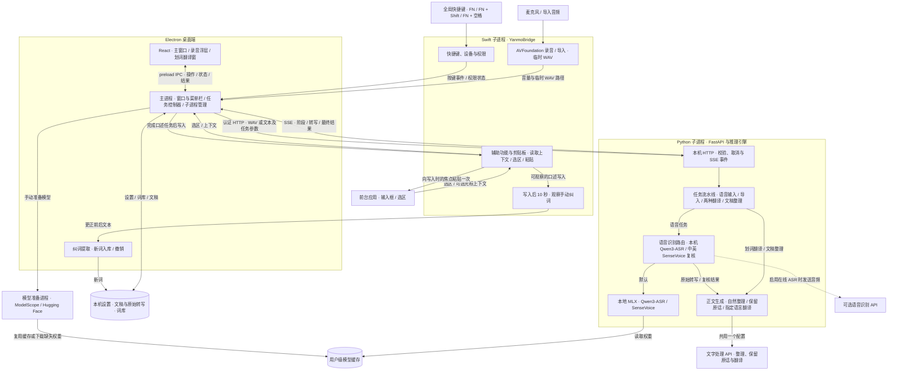

# 言墨当前模块图

2026-11-13 · Apple Silicon Mac 开发版源码。公开安装包 v0.4.4 的架构见[该版本模块图](https://github.com/Happenmass/Yanmo/blob/3c5df91165f14f838961c5e7ea3994afe267265d/docs/architecture/current-modules.md)。

## 各入口如何交付结果

| 入口 | 推理路径 | 交付位置 |
| --- | --- | --- |
| **FN** 语音输入 | 识别 → 自然整理或保留原话，按口述语言输出 | 粘贴到写入时的当前焦点。开启历史时保存正文与识别对照。 |
| **FN + Shift** 口述翻译 | 识别 → 直接翻译到所选语言 | 粘贴到当前焦点。开启历史时保存译文与识别对照。 |
| **FN + 空格** 划词翻译 | 读取选区 → 翻译，保护 Markdown 中的代码 | 独立译文窗口。原选区保持原样，关闭窗口后清除原文和译文。 |
| 导入音频 | 规范化为 WAV → 识别与整理，按音频原语言输出 | 文稿页。开启历史时写入文稿库。 |
| 手动整理文稿 | 使用已保存的识别候选或用户修订正文 → 整理 | 更新当前文稿。 |

## 源码入口

| 模块 | 职责与入口 |
| --- | --- |
| 界面与 IPC | [React 界面](../../desktop/renderer/App.tsx)包含书案、文稿、词库、设置、首次引导、录音浮层和划词翻译窗。[Markdown 渲染](../../desktop/renderer/markdown.ts)负责译文排版。[preload](../../desktop/preload.ts)向界面提供操作和状态订阅。 |
| 桌面主进程 | [main.ts](../../desktop/main.ts)管理窗口、菜单栏、IPC、启动和 API 凭证。[controller.ts](../../desktop/controller.ts)管理任务状态、进度、取消和结果交付。[processes.ts](../../desktop/processes.ts)通过逐行 JSON 与 Swift 桥接通信，通过认证 HTTP/SSE 与后端通信，并在后端连续空闲一小时后回收进程。 |
| 系统桥接 | [YanmoBridge](../../Sources/YanmoBridge/main.swift)调用[快捷键监听](../../Sources/YanmoNative/HotKeys.swift)、[音频设备与录音](../../Sources/YanmoNative/AudioInput.swift)及[系统集成](../../Sources/YanmoNative/SystemIntegration.swift)。光标上下文默认关闭，开启后可读取前后各最多 300 字。录音可在上下文不可读时继续。 |
| 推理后端 | [FastAPI 服务](../../backend/server.py)在本机回环地址启动，校验请求、管理任务并流式回报阶段和结果。[任务流水线](../../backend/pipeline.py)按操作选择识别、复核、整理或翻译。[推理引擎](../../engine/worker.py)组装任务并使用[自然整理提示词](../../engine/polish.txt)构造整理请求。 |
| 本机语音识别与 API | [MLX 适配器](../../engine/mlx_provider.py)运行 Mac 本机识别。[在线适配器](../../engine/online_provider.py)负责调用用户配置的 OpenAI 兼容接口。文字 API 可接收识别结果、词库及已开启的上下文。本地 LLM 实现供独立评测使用。 |
| 数据、纠词和诊断 | [LibraryStore](../../desktop/store.ts)负责本机设置、文稿与词库保存、历史保留和旧版迁移。API 凭证由主进程加密保存。[纠词观察](../../Sources/YanmoNative/CorrectionObservation.swift)在可读输入框中识别写入后的修订，[纠词提取](../../desktop/correction-learning.ts)产生可撤销词条。桌面和[推理诊断](../../engine/diagnostics.py)记录阶段、耗时和错误类型等元数据。 |
| 运行时与模型准备 | [模型准备](../../backend/prepare_models.py)在独立进程中复用或下载全局缓存，[模型缓存](../../engine/model_cache.py)负责查找权重。[Mac 打包](../../package.json)包含 Electron、Swift 桥和 Python 运行时。 |

Windows 主线已有[运行环境预检](../../desktop/precheck.ts)、[运行时安装](../../desktop/windows-runtime.ts)和 [PyTorch/CUDA 适配器](../../engine/torch_provider.py)，仍缺 Win32 系统桥接。独立的 `codex/arti-windows-api` 定制分支已有 Win32 桥接与 API 安装包，原生 Windows 输入仍待实机验收。

[Mac 实现与验收](../electron-mac-2026-10-21.md) · [识别与正文评测](../asr-fusion.md) · [Electron 重构方案](electron_00_Overview_顶层架构.md)
