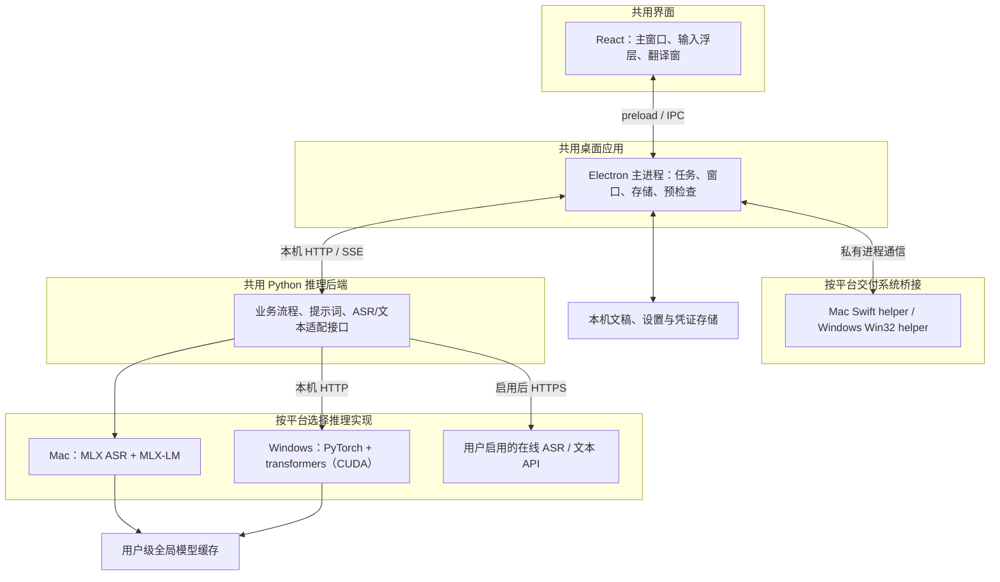
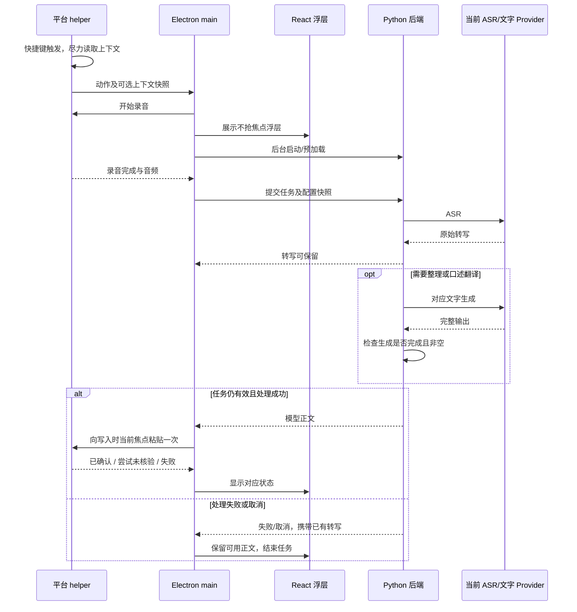

# 言墨 Electron 双平台重构方案

版本：v0.2；日期：2026-10-21；重构前基线：`cb686f5`。Mac 首阶段已实现，Windows 仍按下述方案推进。

目标：共用 Electron 界面、应用流程和推理协议，分别交付 Mac 的 MLX 运行时与 Windows 的 PyTorch（CUDA）运行时，让模型接入方式能够独立调整。

需求依据：本次用户确认的 Electron 重建方向，以及“Mac 默认 MLX；Windows 检查 CUDA，无 CUDA 推荐在线 API”的平台策略。产品行为沿用 [README](../../README.md) 与 [已确认视觉](../design/README.md)。本文给出模块范围和推荐边界，具体版本、接口类型和安装步骤在实施前的专项设计中固定。

实施状态：Mac 的 Electron 界面、Swift helper、独立 Python/MLX 运行时、认证 HTTP/SSE 和旧数据迁移已落地；功能与验证入口见 [Mac 实施记录](../electron-mac-2026-10-21.md)。下文模块清单以重构前原型为基线描述责任划分；2026-10-23 用户决定 Windows 放弃 vLLM/WSL2，改用原生 PyTorch 与 transformers；预检查、无 CUDA 在线分流、运行库安装、模型准备与 PyTorch 推理适配已实现，见 [运行时与预检查](electron_01_Runtime_运行时与预检查.md)；Windows helper 尚未实现。下文涉及 Windows 本地推理处均以该决定为准。

## 0. 术语

| 术语 | 在言墨中的含义 | 依据 |
|---|---|---|
| 桌面端 | Electron 主进程及 React 界面 | 本次需求 |
| 系统桥接 | 负责快捷键、录音、选区和跨应用写入的小型原生进程 | 现有系统集成行为 |
| 推理后端 | 独立 Python 服务，组织识别、整理和翻译 | 本次需求、现有 `engine/` |
| ASR | 将录音转换为原始转写的能力 | 现有 Qwen3-ASR 流程 |
| 文字生成 | 整理或翻译文本的能力，与 ASR 分开配置 | 现有双翻译流程 |
| Provider | 把 MLX、PyTorch 或在线 API 接入统一能力接口的适配器 | 本方案建议 |
| 运行时 | Python、推理库及其原生依赖，不包含模型权重 | 本方案打包边界 |
| 预检查 | 检查硬件、运行时、模型和服务能力，输出可操作状态 | 本次需求 |
| 本地模式 | 音频、转写、词库和上下文均留在本机处理 | 项目 `AGENTS.md` |

## 1. 重构要解决的问题

现有原型由 SwiftUI/AppKit、应用状态和独立 MLX Python 进程组成，已完成输入与翻译闭环。推理虽已隔离，但 Python 环境依赖开发机，界面和系统交互仍集中在 macOS，无法直接交付 Windows 版本。

重构把界面、系统能力、推理业务和引擎实现分开：界面迁入 Electron；平台交互分别适配；后端共用业务规则；安装包只携带对应平台需要的运行时。

后端的职责止于返回模型生成的完整正文。是否保存、是否写入、写到哪个输入框，由桌面端和系统桥接负责。

## 2. 目标与本轮范围

| 目标 | 对应范围限制 |
|---|---|
| G1：Electron 复现已确认界面与水墨动效 | NG1：本轮沿用现有产品设计，不增加视觉改版 |
| G2：Mac 默认离线使用 MLX | NG2：Mac 首版以 Apple Silicon 为目标，不引入 PyTorch MPS 路径 |
| G3：Windows 可用 CUDA 时运行 PyTorch，否则推荐 API | NG3：首版不增加 CPU、DirectML、ROCm 等 Windows 本地后端 |
| G4：模型、引擎、API 可独立切换 | NG4：只做 ASR 与文字生成两个能力接口，不建设通用插件市场 |
| G5：保留输入、双翻译、词库、历史与隐私设置 | NG5：不增加账号、云同步、OCR、问答和多引擎投票 |
| G6：安装包可脱离开发环境运行 | NG6：模型权重使用全局缓存，不随应用打包，不复制个人数据作演示 |

## 3. 输入输出与平台策略

输入为录音或显式选区，加上用户选择的语言、整理风格和可选上下文；输出为可编辑文稿、独立译文，或向写入时当前焦点的一次粘贴。

| 环境 | 默认路径 | 预检查未通过时 |
|---|---|---|
| Apple Silicon Mac | 内置 Python + MLX；复用现有 Qwen3-ASR 与 4B 文本模型 | 区分模型未准备、运行时异常和硬件不支持，提供修复或主动配置 API 的入口 |
| Windows x64，CUDA 与运行条件通过 | 内置 Python 网关 + 本机 PyTorch CUDA 运行库 | 显示缺少的运行条件，支持准备本地运行环境或配置 API |
| Windows，无受支持的 CUDA GPU | 原生 Python 网关 + 在线 API 适配器 | 进入 API 配置引导；未配置成功前不显示“可用” |

Windows 建议先支持 Windows 11 x64。Mac 系统下限以现有 macOS 14 为起点，随锁定的 MLX/Python 依赖验证。Intel Mac 与 Windows ARM 暂列后续范围。

“推荐 API”表示引导用户配置并启用在线处理；不会因为本地检查失败就自动上传录音。已有有效选择在后续启动中保留，预检查不擅自切换已配置的处理方式。

## 4. 分层架构

推荐前端采用 React + TypeScript + Vite，后端采用 Python 3.12 + FastAPI。Electron 主进程管理应用状态和子进程，React 通过窄接口发起动作和订阅状态；模型依赖只进入 Python 运行时。[Electron 进程模型](https://www.electronjs.org/docs/latest/tutorial/process-model)

## 5. 模块改造清单

标记：🆕 新增责任单元；🔧 调整现有实现；➕ 仅扩展协议字段。下列目录为建议布局，不代表已经完成迁移。

### 5.1 后端与运行时

| 模块 | 当前职责 | 改动 | 迁移范围 |
|---|---|---|---|
| `backend/` | 当前入口为 `engine/worker.py` | 🆕 | 从逐行 JSON worker 提取为独立服务，统一任务提示词、正文交付、Markdown代码保护与技术错误语义 |
| `backend/providers/mlx/` | 当前 ASR 与 MLX-LM 直接调用 | 🔧 | 迁入 Mac 专属适配器，优先保持现用模型和行为 |
| `backend/providers/compatible_api/` | 暂无统一 API 接入 | 🆕 | 分别适配转写与文字生成；兼容在线接口复用传输，保留各自能力差异 |
| `runtime/macos/` | 当前使用项目外 Python 路径 | 🆕 | 内置可重定位 Python、MLX 及音频依赖，并固定版本 |
| `runtime/windows/` | 暂无 Windows 推理环境 | 🆕 | 原生 Python 网关、预检查，以及按需安装的 PyTorch CUDA 运行库 |

### 5.2 桌面端与系统桥接

| 模块 | 当前职责 | 改动 | 迁移范围 |
|---|---|---|---|
| `desktop/renderer/` | SwiftUI 主窗口、浮层和翻译窗 | 🆕 | 按现有设计用 Web UI 重建，保留排版/源码、代码着色及动效 |
| `desktop/main/` | `AppModel.swift`、`LocalEngine.swift` 的应用职责 | 🆕 | 任务状态、窗口、后端生命周期、存储、平台预检查与在线配置 |
| `desktop/preload/` | 当前没有 renderer/main 边界 | 🆕 | 仅暴露业务动作和状态订阅，校验 IPC 输入 |
| `native/macos/` | 快捷键、AX上下文/选区、当前焦点粘贴、AVAudioEngine | 🔧 | 抽为 Swift helper，复用已验证的底层行为；去除 SwiftUI 依赖 |
| `native/windows/` | 暂无实现 | 🆕 | Win32 helper 提供快捷键、录音、UI Automation、剪贴板与写入 |

### 5.3 数据与发布资产

| 模块 | 改动 | 范围 |
|---|---|---|
| 业务协议与类型 | 🆕 | TypeScript/Python 共用的任务、事件、错误和能力定义；集中在协议文件中维护 |
| 本机数据与凭证 | 🔧 | 兼容 `library.json`，导入 Mac UserDefaults；平台各自保管凭证 |
| 全局权重缓存 | 🔧 | 默认 ModelScope；复用已有 ModelScope/Hugging Face 全局缓存；Windows 使用同一配置的全局位置 |
| 构建与测试资产 | 🔧 | 增加分平台运行时清单、安装包构建与核心行为回归；保留旧版作迁移对照 |

现有 SwiftUI 应用在迁移验收期间继续作为行为基线。旧版与 Electron 版共享迁移源时采用备份和单写入方，避免同时覆盖文稿库。

## 6. 模块责任边界

| 模块 | 负责 | 不负责 | 上游入口 → 下游输出 |
|---|---|---|---|
| Renderer + preload | 展示状态、编辑正文、发送用户动作 | 进程启动、模型调用和凭证持久化 | 用户操作 → 业务动作；应用事件 → 界面 |
| Electron main | 任务状态、预检查总结果、窗口、保存与写入决策 | 直接加载权重和复制模型算法 | UI/helper 事件 → 系统命令、推理任务、视图状态 |
| Mac / Windows helper | 录音、上下文与选区快照、键盘监听、剪贴板和当前焦点一次粘贴 | 生成文本、保存文稿和选择 Provider | 系统事件/应用命令 → 音频、上下文/选区快照、交付状态 |
| Python 后端 | ASR→整理/翻译流程、提示词与技术完成状态 | 操作输入框、保留历史、控制窗口 | 推理任务 → 阶段事件、原始转写、模型正文 |
| MLX 适配器 | Mac 模型加载与本机推理 | 桌面流程和在线上传 | 标准能力请求 → 标准结果 |
| API 适配器 | 在线接口的参数、能力与结果转换 | 将任意服务视为完全兼容 | 标准能力请求 → 结果/明确错误 |
| 分平台运行时 | 启动、检查和停止应用拥有的推理进程 | 接管用户其他服务或更改系统驱动 | 启动/探测命令 → readiness 与资源状态 |
| 协议、数据、缓存与发布资产 | 类型版本、原子保存、缓存定位和可复现构建 | 复制业务判断或存储演示个人数据 | 业务对象/构建输入 → 本机文件/安装包 |

关键关系：一个交互任务固定一份配置快照；系统 helper 尽力读取上下文，写入使用当时的当前焦点；Python 不知道输入框的位置。文字模型只返回最终正文，程序原样交付；划词翻译的代码原样保护由共用后端执行。

## 7. 已确定方向与建议选型

| 已确定方向 | 内容 | 影响范围 |
|---|---|---|
| Electron 重建 | 共用界面与业务流程，分别构建两个平台安装包 | 桌面端与构建 |
| Mac 默认 MLX | 使用 Apple Silicon 本机推理 | Mac 运行时 |
| Windows 使用 PyTorch（2026-10-23 由 vLLM 改定） | CUDA 不满足时推荐在线 API | Windows 运行时与预检查 |
| 默认下载源 | ModelScope，准备前复用已有完整全局缓存 | 模型准备与缓存 |
| 后端可替换 | 引擎与 API 接入调整不要求重写界面 | Python 接口与协议 |
| 延续产品约束 | 已确认视觉、离线能力、全局缓存、谨慎整理与写入 | 全部模块 |

建议选型是“一个仓库、一套前端、一套后端核心、分平台 helper 与依赖清单”。模型配置分成 ASR 和文字生成两项；首次只实现 MLX、PyTorch/兼容 API 所需的适配，不增加通用插件系统。

## 8. 通信契约与启动预检查

### 8.1 界面到主进程

使用 preload 暴露的明确 IPC 动作：开始、结束、取消、翻译选区、修改设置、配置/检测模型。主进程推送任务阶段、音量、结果和平台能力；协议携带版本与任务 ID，renderer 不接触后端认证信息。采用 context isolation、关闭 Node integration，并限制 Markdown 原始 HTML 与远程资源加载。[Electron 安全说明](https://www.electronjs.org/docs/latest/tutorial/security)

### 8.2 主进程到系统桥接

使用私有 stdin/stdout 结构化消息，普通诊断走 stderr 且不记录正文。命令/事件包括就绪、快捷键触发、录音开始/结束、音量、读取选区、插入和取消；携带协议版本、任务 ID、上下文/选区快照标识、设备标识及必要结果；插入命令只传正文，不绑定录音时目标。

快捷键事件发生时立即捕获目标，再向主进程发事件。写入返回 `confirmed`、`attempted_unverified`、`failed` 三种结果；未确认的粘贴不自动重试，避免重复输入。音量事件限频，单独与推理结果传输。

### 8.3 主进程到 Python 后端

| 契约草案 | 触发与频率 | 主要内容 |
|---|---|---|
| 启动握手 | 每次后端启动一次，私有管道报告 | 协议版本、本机动态端口；认证信息留在私有启动通道 |
| `GET /v1/status` | 启动、配置变更、用户重新检测 | 引擎、模式、能力、模型缓存/加载状态、失败原因 |
| `POST /v1/warmup` | 录音开始后按需发起 | 本次需要的 ASR/文字模型；失败不阻断录音 |
| `POST /v1/tasks` + SSE 响应 | 每个推理任务一次 | 任务 ID、操作、音频上传或文本、语言、配置快照、可选上下文 |
| `POST /v1/tasks/{id}/cancel` | 用户取消或应用退出 | 取消指定任务；迟到结果失效 |

SSE 统一返回阶段变化、原始转写、最终结果或终止错误；部分 token 不作为可写入结果。传音频内容而非 Windows/Mac 私有路径。首版只保留一个前台交互任务，不建设持久队列。版本以 `/v1` 为边界。

### 8.4 后端到推理实现

Mac 在 Python 中调用 MLX ASR/MLX-LM；Windows 在同一后端进程中以 PyTorch/transformers 调用 Qwen3-ASR 与文字模型。转写与文字生成是两个模型能力，分别探测。在线端点只接受用户启用的配置，适配器按实际支持项映射转写、Chat Completions、长度与结束原因。

本机服务限制在 loopback，通过临时认证信息访问，不将服务绑定到局域网。

### 8.5 启动预检查与选择规则

| 检查阶段 | Mac | Windows |
|---|---|---|
| 轻量环境检查 | 架构、系统、Metal、内置 Python/MLX | 架构、受支持 NVIDIA GPU、PyTorch 运行库是否就绪 |
| 模型准备检查 | 现有 MLX 权重与 tokenizer 是否完整 | CUDA 可用性、GPU 架构、模型格式、可用显存与全局缓存 |
| 能力验证 | 模型加载与必要推理检查；加载与录音重叠 | 在实际 PyTorch 运行库中检查 CUDA 和模型；不能只看宿主 `nvidia-smi` |
| 在线配置验证 | 用户主动选择时检测 | 无可用 CUDA 时直接推荐；分别验证 ASR 和文字生成 |

状态至少区分“检查中、本地可用、模型待准备、本地环境待修复、推荐在线、API 待配置、在线可用”。普通启动不重复完整推理基准；依赖或模型变更后重新验证，按需加载状态单独显示。

CUDA 判断针对捆绑运行时能否实际执行，不以是否安装系统 CUDA Toolkit 为判据。GPU 架构与驱动要求随锁定的 PyTorch CUDA 版本记录在兼容矩阵中。

## 9. 语音输入时序

选区翻译从 helper 的显式选区读取开始，沿用相同推理协议；结果只进翻译窗，关闭后清除，不自动替换原选区或保存翻译历史。

## 10. 故障处理与打包边界

| 情况 | 处理方式 | 影响范围 |
|---|---|---|
| Windows 无受支持 CUDA | 直接推荐在线配置，跳过本地模型加载 | 本地推理入口 |
| 有 GPU，但驱动/运行库未就绪 | 给出具体修复项，同时可选 API；运行库安装由用户明确发起 | Windows 本地运行时 |
| 显存不足或双模型争用 | 为 ASR/文本分别设预算并实测；可顺序驻留，达不到交互要求时推荐 API | Windows 模型调度 |
| API 只支持文本或转写 | 逐项显示能力；没有 ASR 就不能标记语音输入就绪 | 在线模式 |
| 后端异常、超时、空输出或生成截断 | 保留已识别原文；停止自动写入；用户可重试 | 当前任务 |
| 浮层影响原应用焦点 | 阻止该窗口配置进入发布版，修正平台窗口行为 | 输入交互 |
| 权限不足或键盘投递失败 | 保留正文并显示原因；目标切换不阻止写入，插入不依赖AX读回 | 写入 |
| 模型缺失或缓存损坏 | 显示“待准备”，提供明确下载/选择目录入口 | 对应模型 |
| 活跃任务期间取消或更换配置 | 旧任务作废，阻止迟到结果写入；配置在下一任务生效 | 当前任务 |

安装包按平台构建：

| 产物 | 随附内容 | 外部条件 |
|---|---|---|
| Mac arm64 应用/DMG | Electron、Swift helper、独立 Python、MLX/MLX-LM/音频依赖 | 系统权限与全局模型缓存 |
| Windows x64 安装器 | Electron、Win32 helper、原生 Python 网关；PyTorch CUDA 运行库在启用本地模式时下载 | 本地模式需要可用 NVIDIA 驱动；在线模式无需 |

Windows 的 PyTorch 运行库在用户启用本地模式时按锁文件安装到 Local AppData（约 2.1 GB），不随安装包分发，模型另存全局缓存；无需管理员权限或重启。

Python 优先使用可重定位的独立发行版，加上构建时锁定的 wheels；运行时与 helper 放在应用资源区、ASAR 外。现有 `.venv` 不直接复制进安装包，也不依赖用户安装 Python/Homebrew/开发工具。冻结为单文件可执行程序留作打包评估选项。[Python 独立发行版](https://gregoryszorc.com/docs/python-build-standalone/main/distributions.html)、[electron-builder 资源打包](https://www.electron.build/contents/)

模型准备默认来源为 ModelScope，与日常离线推理分开。Mac 新下载进入 `~/.cache/codex/models/modelscope/`，复用 SDK 既有缓存及 `~/.cache/huggingface/`；`MODELSCOPE_CACHE` 可指向其他用户级全局位置。Windows 使用相同缓存政策；不复制已有完整权重。Mac MLX 量化文件与 transformers 格式分别准备，不能假设权重文件通用。

## 11. 端到端验收约束

1. 两个安装包使用相同的业务任务与结果协议，换 Provider 不要求改界面代码。
2. Mac 的默认输入、整理和双翻译在断网状态可完成；Windows 本地模式准备完成后也可断网执行。
3. Windows 无 CUDA 时不安装本地运行库，不下载本地权重；API 未启用前不上传输入内容。
4. 在线 ASR 与文字 API 分别标记可用性；用户可明确配置本地识别配合在线文字处理，发送范围可见。
5. 本地模式不发送遥测或请求正文；两种模式均不将凭证、词库、上下文或录音写入诊断日志。
6. 临时录音在完成、取消和受控错误后删除；历史开关、保留周期和选区翻译不留历史的规则保持有效。
7. ASR、整理和翻译保持独立：口述翻译直接 ASR→翻译，整理开关不影响翻译。
8. 转录逐段保留源语言，翻译才转换；数字按语义自然书写，程序采用模型正文。划词翻译保留Markdown与代码；技术错误、截断和取消不写入。
9. 浮层维持 200×36 的视觉尺寸、不抢焦点、无声音；隐藏后暂停动效，尊重减弱动态效果。
10. Mac Fn/纯修饰键/Control＋空格保留已验证语义；Windows 首版提供可用默认组合键，Fn 仅在硬件可观察时开放，不承诺逐键等同。
11. 上下文与选区句柄只留在helper；用户可在录音/处理期间切换目标，插入始终采用写入时当前焦点，每次只粘贴一次。
12. 活跃录音与推理保护模型进程；连续空闲 3600 秒退出应用拥有的模型进程，录音后可后台重载；用户自己的远端服务不受停止操作影响。
13. Mac 迁移先备份再原子导入；保留 UUID、日期、词库、快捷键、语言及隐私设置，导入失败不覆盖原库。
14. 在没有开发 Python、项目路径和构建环境的干净机器/账户上验证安装、权限、推理和退出，不把开发机成功当作独立打包成功。

## 12. 迁移顺序与后续设计

| 阶段 | 主要工作 | 完成判据 | 后续详细设计 |
|---|---|---|---|
| P0：运行时与预检查 | Mac 内置 MLX 最小包；Windows PyTorch 运行库及无 CUDA 分流验证；记录运行时体积 | Mac 脱离项目环境执行；Windows 有/无 CUDA 和运行库缺失均返回正确状态 | `electron_01_Runtime_运行时与预检查.md` |
| P1：共用推理后端 | 统一任务提示词与正文协议，接入MLX、PyTorch/兼容API | 相同合成样本覆盖本地后端及API；语言、融合、翻译效果及正文完整交付通过评测 | `electron_02_Backend_推理协议.md` |
| P2：跨平台输入闭环 | 最小 Electron 壳、两个 helper、录音浮层、一次写入 | 两平台真实快捷键→录音→推理→写入时当前焦点；途中切换目标仍正确投递，取消不写入 | `electron_03_Native_系统交互.md` |
| P3：完整界面与数据 | 主窗口、双翻译、文稿/词库/设置、Mac 数据导入 | 按确认视觉验收，原型功能逐项对照，隐私与历史设置保留 | 沿用 `docs/design/`，新增配置界面先做视觉确认 |
| P4：发布验收 | 干净环境安装、Mac 签名/公证、Windows 签名、升级/卸载 | 两个平台分别完成发布检查，权重与个人数据不进入构建产物 | `electron_04_Release_分发验收.md` |

不在重构中同时更换 Mac 默认模型、重写整理提示词或调整已确认交互。Windows 的模型格式与量化方案单独验收，用结果质量、冷启动、暖请求耗时和内存/显存确定基线。

## 13. 待验证事项

1. Windows 首批目标 GPU 与显存档位是什么？这决定两模型可否常驻及首版可承诺的延迟；以实机矩阵固定，不根据 CUDA 存在与否直接判定。
2. PyTorch 运行库（约 2.1 GB）在实机的安装耗时与驱动兼容性是否满足安装体验？
3. 首批在线 API 服务分别提供哪些 ASR/文字接口？先支持一种经验证的兼容协议，供应商差异留在适配器中。

以上影响细节与发布范围；Electron 共用界面、Mac MLX、Windows PyTorch/无 CUDA 推荐 API 的方向已按用户决定固定。Mac 已完成首阶段实现；下一阶段优先落实 Windows 运行时与预检查，并验证在线 ASR/文字接口。

## 14. 依据与参考

本地依据（基线 `cb686f5`）：[开发约定](../../AGENTS.md)、[功能与运行说明](../../README.md)、[视觉与动效](../design/README.md)、[双翻译](../translation-0.3.md)、[Markdown 与富文本](../markdown-translation-2026-10-21.md)、[快捷键](../control-space-2026-10-21.md)、[模型生命周期](../model-idle-2026-10-21.md)。现有入口：`Sources/Yanmo/AppModel.swift`、`LocalEngine.swift`、`Shortcuts.swift`、`SystemIntegration.swift`、`AudioInput.swift`、`Sources/YanmoCore/Models.swift`、`engine/worker.py` 与现有检查程序。

官方参考（2026-10-21 查阅）：

- [transformers Qwen3-ASR](https://huggingface.co/docs/transformers/model_doc/qwen3_asr)：`-hf` 格式权重、转写请求与解码。
- [PyTorch 安装](https://pytorch.org/get-started/locally/)：Windows CUDA 版本与索引。
- [Electron 进程模型](https://www.electronjs.org/docs/latest/tutorial/process-model)、[BrowserWindow](https://www.electronjs.org/docs/latest/api/browser-window)、[安全说明](https://www.electronjs.org/docs/latest/tutorial/security)：主进程/renderer、非激活显示与权限边界。
- [Win32 热键](https://learn.microsoft.com/en-us/windows/win32/api/winuser/nf-winuser-registerhotkey)、[UI Automation](https://learn.microsoft.com/en-us/windows/win32/winauto/entry-uiauto-win32)：Windows 系统桥接入口。
- [Python 独立发行版](https://gregoryszorc.com/docs/python-build-standalone/main/distributions.html)、[electron-builder 资源打包](https://www.electron.build/contents/)：运行时随应用分发的基础。
