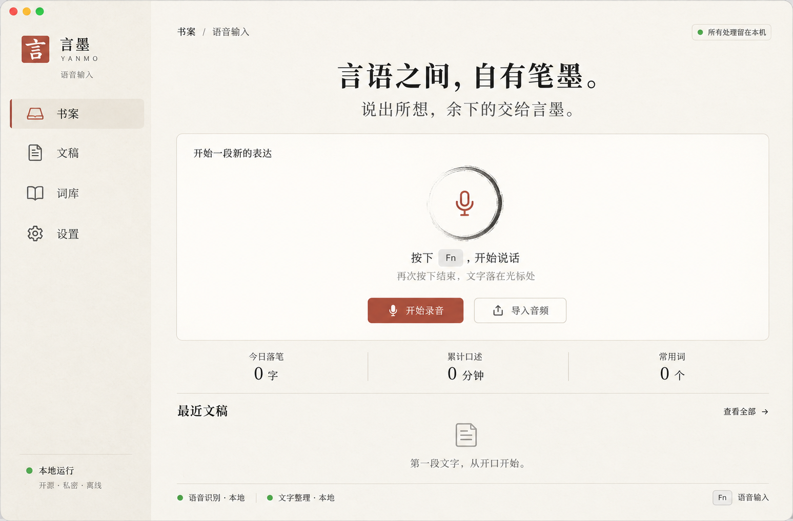
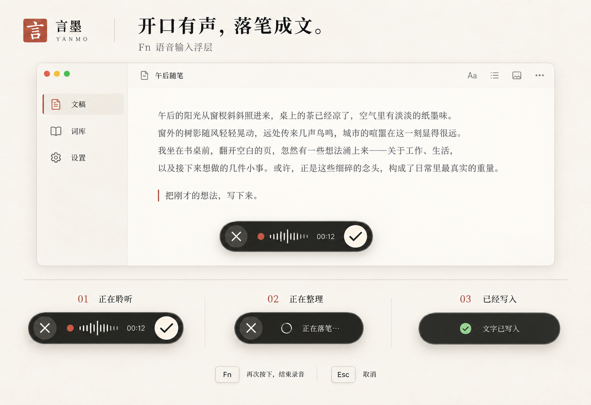

# 言墨视觉方案

2026-10-21 · v1 概念稿已确认；0.2 根据用户反馈修订

先用 Image Gen 对齐视觉，再按确认后的图片实现。两张图片保留为初始视觉依据；下述 0.2 修订由用户直接提出，优先于旧图中的布局。实际状态与统计以应用的真实数据为准。

## 主窗口

- 宣纸白、墨色、朱砂、少量玉色状态提示，宋体标题搭配清晰的现代控件文字。
- 左侧书案／文稿／词库／设置；首页只展示真实使用概览、落笔日历、快捷键说明、导入入口和最近文稿。
- 首页没有录音状态、大麦克风或重复的录音控制；录音反馈集中在底部浮层。
- 图内绿色状态是设计示例；实现时只在模型与运行环境实际可用时点亮。

## Fn 语音输入浮层

- 200×36 pt 黑墨胶囊悬于当前应用底部，不抢占输入焦点。
- 无提示音、无麦克风监听回放；不用弹跳、光晕和装饰波形。真实音量驱动一笔横向墨线（粗细即音量，两端收锋），静音时为静止细线。
- 目标应用仅在悬停提示与辅助功能标签呈现，不额外增加一行浮层。
- 聆听：取消、音量波形、时长、结束录音；整理：取消与进度；写入后短暂确认。
- Fn 再按结束，Esc 取消；处理失败、权限不足或写入失败必须给出明确状态并保留可复制正文，不能显示写入成功。
- 参考截图只用于理解紧凑体积和按钮层级；未复制第三方代码或资产。

完整生成提示词见 [prompts-v1.md](prompts-v1.md)。

## 水墨动效（2026-10-21）

用户反馈界面像静态图片拼接，加入克制的水墨动效；实现集中在 `Sources/Yanmo/InkMotion.swift`。原则：墨落纸上——由虚到实洇开、一笔铺开或滴墨化开；无弹跳、无光晕；开启“减弱动态效果”时退化为普通淡入。

- 浮层：出现时自左向右如一笔铺开（0.3 s），消失为 0.14 s 淡出；状态切换洇开；识别/整理/翻译时右侧滴墨化开；写入成功的勾为一笔写出。
- 主窗口：切页由虚到实洇开；侧栏选中底色与朱砂竖笔滑到新页；启动时印章按下；底部一层生成式远山淡墨，只在出现时洇开一次，之后静止不耗 CPU。
- 书案：标题如毛笔自左向右写出，统计与最近文稿依次洇开，落笔日历按周逐列渗开；数字变化用数字滚动过渡。
- 划词翻译：加载时滴墨化开。

