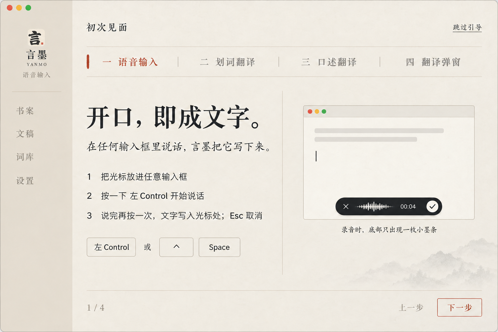
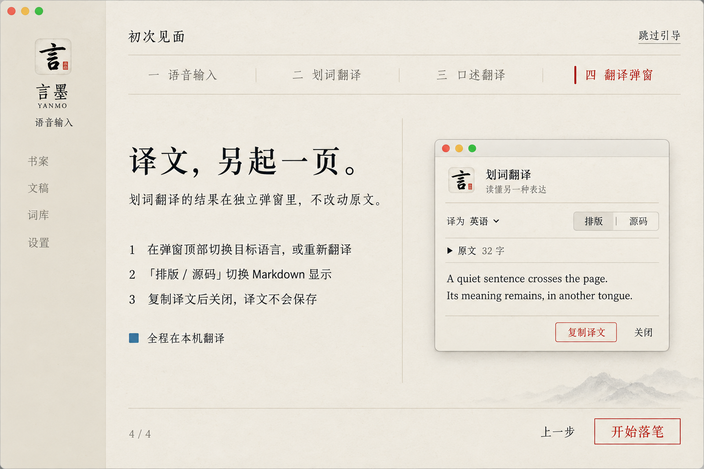

# 言墨视觉方案

2026-10-21 · v1 概念稿已确认；0.2 根据用户反馈修订

先用 Image Gen 对齐视觉，再按确认后的图片实现。两张图片保留为初始视觉依据；下述 0.2 修订由用户直接提出，优先于旧图中的布局。实际状态与统计以应用的真实数据为准。

## 主窗口

- 宣纸白、墨色、朱砂、少量玉色状态提示，宋体标题搭配清晰的现代控件文字。
- 左侧书案／文稿／词库／设置；首页只展示真实使用概览、落笔日历、快捷键说明、导入入口和最近文稿。
- 首页没有录音状态、大麦克风或重复的录音控制；录音反馈集中在底部浮层。
- 图内绿色状态是设计示例；实现时只在模型与运行环境实际可用时点亮。

## Fn 语音输入浮层

- 200×36 pt 黑墨胶囊悬于当前应用底部，不抢占输入焦点。
- 无提示音、无麦克风监听回放；不用弹跳、光晕和装饰波形。真实音量驱动一笔干笔墨迹（2026-10-21 用户修订，取代 v1 图中的竖条波形）：淡墨晕底上叠多根笔毫，音量即笔压；右端为圆润湿润的笔头，左端渐枯成飞白；静音时为静止细线。
- 取消与结束按钮距胶囊各边均 5 px，与两端圆弧同心。
- 目标应用仅在悬停提示与辅助功能标签呈现，不额外增加一行浮层。
- 聆听：取消、音量波形、时长、结束录音；整理：取消与进度；写入后短暂确认。
- Fn 再按结束，Esc 取消；处理失败、权限不足或写入失败必须给出明确状态并保留可复制正文，不能显示写入成功。
- 参考截图只用于理解紧凑体积和按钮层级；未复制第三方代码或资产。

完整生成提示词见 [prompts-v1.md](prompts-v1.md)。

## 主窗口 v2「乌丝栏」（2026-10-22 已确认并实现）

- 去卡片化：内容以乌丝栏式细线与留白分隔，窗口内圆角 ≤2px；输入框只留下划线。
- 主操作为朱文印式方框细线按钮；次操作为带细下划线的墨色文字；导航去图标，纯宋体字，选中为朱砂短竖笔。
- 导航的键盘焦点框只围住文字，避免整行外框被侧栏裁剪成上下横线；鼠标操作仍只显示选中竖笔。
- 色名化：宣纸、玄青、淡墨、朱砂（仅品牌/当前页/唯一主操作）、石青方点表示就绪、赭石用于警示，不再用红色报错。
- 字体：标题宋体（思源宋体类），辅助文案楷体（霞鹜文楷类），控件无衬线；日期可用「十月廿二」。
- 远山只占空白角落，不压文字。两张稿侧栏略有差异，按用户要求统一以书案稿为准。
- 实现在 `desktop/renderer/`：字体用系统宋体／楷体（Songti SC、Kaiti SC），装有思源宋体或霞鹜文楷时优先使用，不随包分发字体；划词翻译与设置页沿用同一套按钮和细线规则。提示词见 [prompts-v2.md](prompts-v2.md)。

## 首次使用引导（2026-10-22 已确认并实现）

- 全新安装首次打开时，主区换成四步引导：语音输入 → 划词翻译 → 口述翻译 → 翻译弹窗；侧栏变淡且不可操作。二、三步沿用同一版式，未单独出图。
- 版式：「初次见面」与「跳过引导」、乌丝栏步骤条（当前步朱砂短竖笔）、左文右图、底部页码与「上一步／下一步」，末步主按钮为「开始落笔」。
- 快捷键与目标语言读取用户当前设置。前三步右侧是真实的「试写区」（2026-10-22 用户要求）：进入即获得焦点，可直接打字，也可按快捷键口述写入；第二步预置一句虚构英文并选中一段，可直接试划词翻译。第四步保留弹窗缩略图。
- 已有设置文件或从 0.3 迁移的用户不显示；设置页「启动」节可「重新查看引导」。提示词见 [prompts-onboarding.md](prompts-onboarding.md)。

## 水墨 Logo v2（2026-10-21 已确认）

- 用户确认采用并替换：宣纸底、浓墨手书“言”字、飞白笔触与右下朱砂小印；底部收笔带对话气泡的形态。
- 应用图标、启动界面、侧栏和划词翻译标识共用此原图；macOS 图标由 `scripts/make-icon.swift` 生成各尺寸与透明圆角。
- 完整生成提示词见 [logo-v2-prompt.md](logo-v2-prompt.md)。

## 菜单栏笔锋图标（2026-10-21）

- 根据用户反馈，以单色笔锋替换菜单栏宋体“言”字；笔尖保留一条收窄的飞白，独立适配小尺寸。
- 自绘矢量路径保存在 `scripts/make-tray.swift`，构建时生成20×20与40×40像素的 `tray.png`／`tray@2x.png`；Electron自动读取1×／2×表示，逻辑尺寸20pt。
- 透明边距每侧至少2pt，保持系统template渲染，随菜单栏背景及选中状态自动变化。应用水墨Logo继续用于Dock和窗口标识。

## 水墨动效（2026-10-21）

用户反馈界面像静态图片拼接，加入克制的水墨动效；Electron 实现在 `desktop/renderer/`，原生原型在 `Sources/Yanmo/InkMotion.swift`。原则：墨落纸上——由虚到实洇开、一笔铺开或滴墨化开；无弹跳、无光晕；开启“减弱动态效果”时移除位移与复杂动效。

- 浮层：依用户新要求，出现时从下方 20 px 向上浮入并淡入（0.32 s），消失为 0.16 s 淡出；每次唤起重播，状态切换与音量变化不重复位移。可见胶囊仍为 200×36，底边距工作区 30 px，透明窗口留足动画空间；状态切换洇开，处理时右侧滴墨化开，成功的勾为一笔写出。
- 主窗口：切页由虚到实洇开；侧栏选中底色与朱砂竖笔滑到新页；启动时印章按下；底部一层生成式远山淡墨，只在出现时洇开一次，之后静止不耗 CPU。
- 书案：标题如毛笔自左向右写出，统计与最近文稿依次洇开，落笔日历按周逐列渗开；统计数字变化时新值重新洇开。
- 划词翻译：加载时滴墨化开；译文按段落依次洇开，复制后「已复制」洇开替换。
- 交互（2026-10-22）：按下按钮时在指针处滴一点墨晕开（0.8 s，取按钮当前文字色，形状与方向每次略异）；朱文印主按钮按下时轻压；文稿选中竖笔自上而下写出，新文稿、词条与快捷键录制框出现时洇开；就绪点颜色缓慢浸入。

