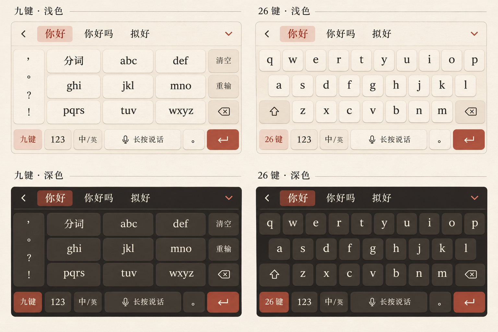
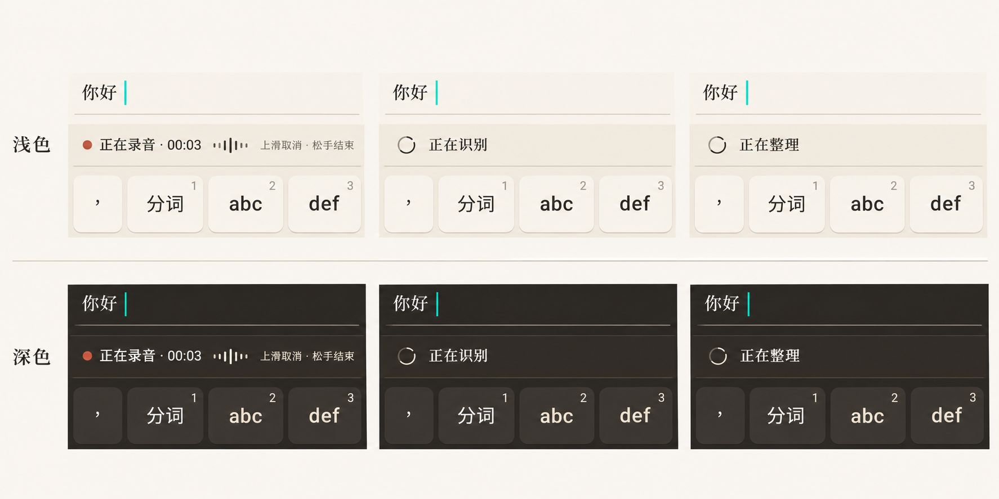
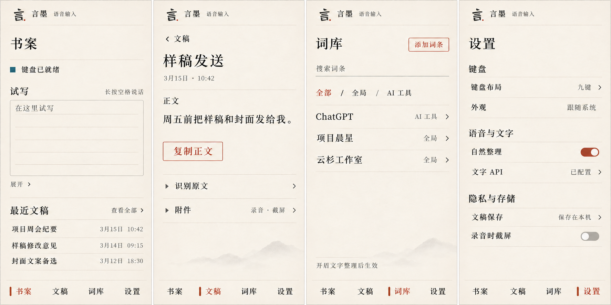

# 言墨安卓交互概念稿

2026-11-19 · Image Gen 第一轮 · [查看第二轮评审稿](android-v2.md)

## 键盘

左列是九键，右列是 26 键，深浅色使用同一布局。底栏分别提供布局选择和中英切换。空格上的「长按说话」提示兼顾入口可见性和短按输入。长按开始，松手结束，上滑取消。语音录入期间由同一行显示录音时长、识别和整理状态。关闭整理时，识别结束即走写入流程。

键帽细节仍需按真机校准。图上省略了九键编码中的部分数字角标和右侧功能键变化，普通输入验收沿用已通过的键位行为。

## 主应用

- 书案展示就绪状态、可展开的多行试写和最近文稿。首次使用时，就绪区域展示当前需要完成的步骤。
- 文稿稿面展示详情。正文和复制操作优先，识别原文及附件下沉到折叠区。点击最近文稿进入详情，「查看全部」进入按日期组织的列表。
- 词库支持添加、搜索、分类和编辑；稿面的生效范围是已启用的文字整理，实际本地识别热词需另行接入 SDK。
- 设置按键盘、语音与文字、隐私与存储组织。系统深浅色作为主应用和键盘的默认外观。

## Image Gen 生成要点

- 键盘以安卓实测九键、26 键和长按录音截图作布局参考。用同一组布局对照宣纸浅色和暖墨深色，减少工具入口，突出空格听写提示。状态稿采用三列两行对照出图，以同一高度的候选栏承载录音、识别和整理。
- 主应用以 [Mac 书案](main-window-v2.png) 和 [Mac 文稿](manuscripts-v2.png) 的「乌丝栏」稿为参考。保留宋体标题、细线分隔、朱砂选中笔和宣纸留白，把桌面侧栏映射成手机底部四个文字标签。试写区在首屏预留多行；四屏使用合成示例文本。
