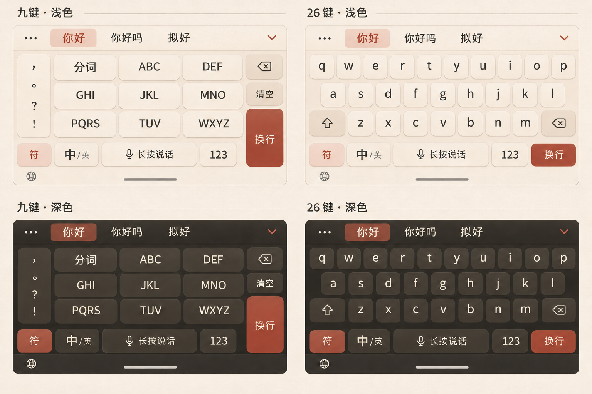
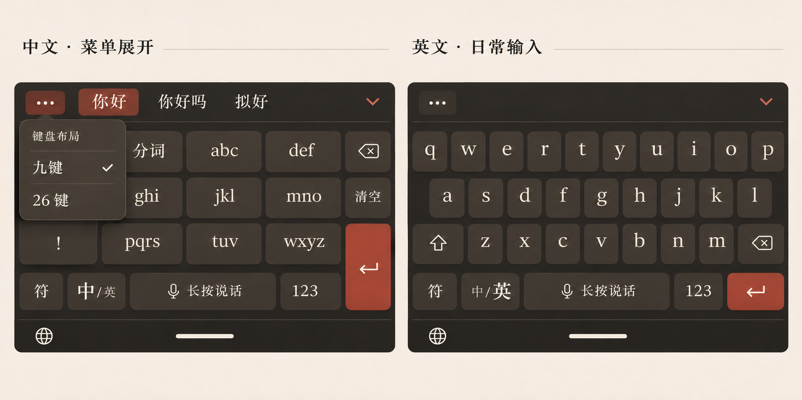
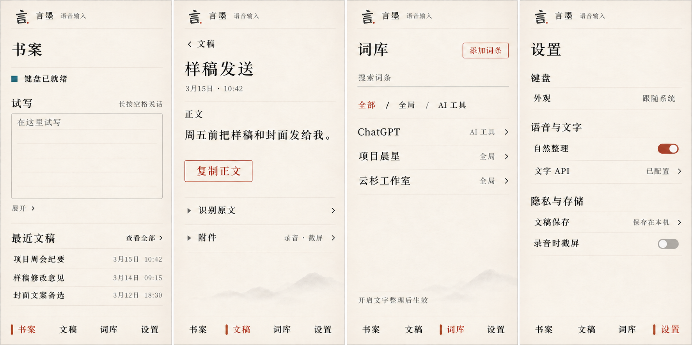

# 言墨安卓交互稿

2026-11-19 · Image Gen 第二轮 · 已确认（顶部菜单沿用现有样式和路径）

## 键盘布局

九键沿用常用输入法的大区块布局：左侧是一列常用标点，右下是一颗跨两行的换行键。九键和 26 键都把「中／英」放在宽空格键左侧，「123」在右侧。图中省略了部分数字角标和组合输入时的动态键帽。

## 三个切换入口

| 位置 | 行为 |
| --- | --- |
| 顶部原有布局菜单 | 沿用现有工具栏、菜单样式与九键／26 键的切换路径。图里的「⋯」和弹层只示意布局选项在展开后出现，实际以现有菜单为准。 |
| 空格左侧「中／英」 | 单击直接切换言墨内的打字语言。字序固定，当前语言字号更大、对比更高。提案以 26 键输入英文，切回中文恢复上次选择的中文布局。 |
| 键盘下方系统栏的地球图标 | 保留系统输入法切换入口。图的位置按参考设备示意，实际由系统导航栏决定。 |

空格短按照常输入，长按说话、松手结束、上滑取消。听写识别维持自动判断语言，中英键控制打字语言。录音、识别、整理占用同一条状态栏，见[语音状态稿](android-voice-states-v1.png)。

## 主应用

- 书案展示就绪状态、可展开试写及最近文稿。未就绪时展示当前需要完成的步骤。
- 文稿按日期浏览，详情优先展示正文与复制操作，识别原文与附件按需展开。
- 词库支持添加、搜索、分类和编辑。词条用于已启用的文字整理。
- 设置按键盘、语音与文字、隐私与存储组织。键盘和主应用跟随系统深浅色，布局选项留在输入法顶部菜单。

## Image Gen 生成要点

- 以言墨第一轮设计为视觉参考，根据用户常用输入法的截图提炼拇指区的按键顺序、跨行换行键与系统栏位置。单独出一张中文菜单展开与英文日常输入的对照稿。
- 主应用只修订设置页的布局入口，沿用第一轮的宣纸、宋体、细线和朱砂选中笔。
