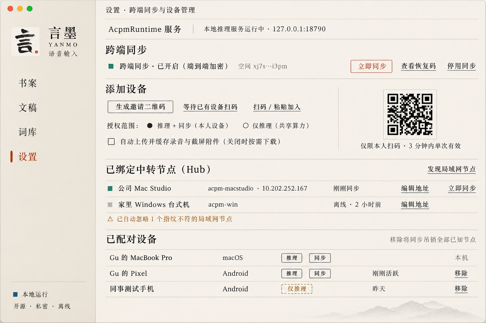

# 设置 · 跨端同步与设备管理 v2（待确认）

2026-11-25 · 对应 [跨端加密同步与发现协议](../architecture/acpm-sync-protocol.md) Phase 3B 与代码安全审查（M1 / M9）修订。直接以原始干净的 `main-window-v2.png` 为唯一参考，通过 Codex 内置 `image_generation` 能力**单次直接生成**（1536 × 1024 PNG，避免多代图生图叠代产生噪点与伪影），沿用「乌丝栏」v2 设置页排版规则，待用户确认设计稿后再于 `desktop/renderer/` 实现。



> 初版对照稿保留于 [sync-settings-v1.png](sync-settings-v1.png) 与 [sync-settings-v1.md](sync-settings-v1.md)。

## 相比 v1 的主要修订（对齐审查 M1 / M9）

1. **纠偏二维码安全提示（M1）**：将 v1 二维码下方易引起误解的「不含空间根密钥」改为 **`仅限本人扫码 · 3 分钟内单次有效`**；并在选择「仅推理（共享算力）」生成共享二维码时不注入 `encrypted_seed_box`。
2. **补齐已实现流程入口（M9）**：
   - 在「跨端同步」操作区补充「**停用同步**」（对应 `syncDisable` + 原生确认弹窗）。
   - 在「添加设备」增加「**等待已有设备扫码**」（对应 `join_wait` 模式 `syncCreateJoinWait` / `syncCompleteJoinWait`）及「**授权范围**」单选（`推理 + 同步` / `仅推理`）。
   - 将「自动上传并缓存录音与截屏附件（关闭时按需下载）」默认形态统一修正为**未勾选**状态，消除 v1 图文矛盾。
3. **节点发现与防伪状态显性化（M9）**：
   - 「已绑定中转节点（Hub）」标题行右侧增加「**发现局域网节点**」（对应 `syncDiscoverHubs`），已连接节点同步显示「**编辑地址**」（对应 `syncSetHubUrl`）。
   - 当检测到伪造或指纹不符节点时，使用克制淡赭石色（`#9c6334`）展示提示行「`△ 已自动忽略 N 个指纹不符的局域网节点`」（替代红色报错）。
4. **明确吊销作用范围（M5 / M9）**：
   - 「已配对设备」标题行右侧标明「`移除将同步吊销全部已知节点`」，提示 `syncRevokeDevice` 会广播到所有已配对 Hub。

## 界面元素与后端 IPC 映射

| 界面区域 / 控件 | 对应协议或主进程能力 | 备注 |
| --- | --- | --- |
| 空间状态 / 列表刷新 | `syncStatus`、`syncEnableLocal` | 钥匙串读取失败时展示 `SyncStateSummary.error` |
| `立即同步`（全局 / 单节点） | `syncNow` | 可传入 `hubId` 与 `uploadBlobs` |
| `查看恢复码` | `syncExportRecoveryCode` | 主进程 `dialog.showMessageBox` 二次确认 |
| `停用同步` | `syncDisable` | 原生确认后清除本地密钥、已知节点与同步游标 |
| `生成邀请二维码` / 授权范围 | `syncCreateInvite` | 支持 `['inference', 'yanmo.sync']` 与 `['inference']` |
| `等待已有设备扫码` | `syncCreateJoinWait`、`syncCompleteJoinWait` | 新电脑展示 `join_wait` 二维码后轮询兑换并注册 |
| `扫码 / 粘贴加入` | `syncRedeemInvite`、`syncRestoreRecoveryCode` | 已有空间时先弹窗确认替换再重设同步表 |
| `自动上传并缓存录音与截屏附件` | `settings` 开关（Phase 3B 实施时接入） | 默认关闭；关闭时 `yanmo:manuscriptAttachments` 按需下载 |
| `发现局域网节点` / 伪造提示 | `syncDiscoverHubs` | 返回 `matched`、`spoofedHubIds`、`unknownCount`（Phase 3B 写入 `SyncStateSummary`） |
| `编辑地址` | `syncSetHubUrl` | 校验证书允许的 HTTPS / 内网 / `.local` 地址 |
| 设备列表 / 权限 / `移除` | `syncListDevices`、`syncUpdateDevice`、`syncRevokeDevice` | 不指定 `hubId` 时吊销全部已知节点 |

## Codex Image Gen 提示词

参考图为当前目录原始干净的 `main-window-v2.png`，通过 `codex exec` 调用内置 `image_generation` 单次直接生成（禁止基于中间生成稿二次局部修补）。

```text
必须调用你内置的 image_generation 工具，仅以附图 docs/design/main-window-v2.png 作为唯一视觉风格参考，一次性直接生成一张高保真、Retina 级锐利干净的 macOS 桌面应用界面设计稿，并将生成的 PNG（优先 2304x1536，若工具限制则 1536x1024）保存到 /Users/guhappen/code/Yanmo/docs/design/sync-settings-v2.png。

【关键抗伪影纪律（必须严格遵守）】：
1. 单次生成禁止叠加修图：严禁在第一张生成图上再发起第二次图生图/局部重绘修补；严禁读取或参考 docs/design/sync-settings-v1.png（避免多代重绘累积噪点与模糊）；严禁用 HTML/SVG/Canvas/Python 脚本渲染代替 image_generation。
2. 底面与线条洁净度：背景采用均匀干净的浅宣纸白 #f6f3ec 与纯白微暖对比，不要加粗糙纸纹噪点、黑点斑驳或水彩脏污晕染；所有 1px 乌丝栏细横线与矩形边框必须平直锐利、无双影或灰晕；文字边缘清晰锐利、笔画完整无粘连。
3. 几何控件清晰：所有圆角 ≤2px、无气泡阴影卡片；单选圆点必须是标准正圆实心点 ● 与标准正圆空心圈 ○（不要压扁）；复选框 ☐ 必须是规整空心小方框，绝对不要打勾；右下角只保留极淡柔和的远山轮廓，且完全避开下方设备列表和文字。

界面构图与完整文案规范：
- 窗口外壳：标准 macOS 窗口，左上方红黄绿三色交通灯，顶栏细分隔线与标题「设置 · 跨端同步与设备管理」。
- 左侧窄导航栏（与附图 main-window-v2.png 严格一致）：顶部水墨「言」字方印与 言墨 / YANMO / 语音输入；四项宋体导航 书案、文稿、词库、设置，当前选中 设置 并在左侧带一条朱砂色（#b63d2c）短竖笔；左下角状态 本地运行 / 开源 · 私密 · 离线。

- 右侧主内容区（留白充裕、各块以 1px 浅墨横线分隔）：
  - 顶缘服务行：AcpmRuntime 服务 本地推理服务运行中 · 127.0.0.1:18790
  - 第 1 块：宋体标题「跨端同步」与状态行：
    - 左侧：石青色（#2f6f6d）小方点 + 跨端同步 · 已开启（端到端加密） + 淡墨字符 空间 xj7s…i3pm
    - 右侧：朱文印式细线矩形主按钮 立即同步（朱砂细框 #b63d2c + 朱砂字），旁列两个带细下划线的墨色文字操作 查看恢复码、停用同步
  - 第 2 块：宋体标题「添加设备」双栏区（左右留白分栏，无外框）：
    - 左栏第 1 行：1px 细墨框按钮 生成邀请二维码，旁列下划线操作 等待已有设备扫码、扫码 / 粘贴加入
    - 左栏第 2 行：授权范围： ● 推理 + 同步（本人设备） ○ 仅推理（共享算力）
    - 左栏第 3 行：空心未选方框 ☐ 自动上传并缓存录音与截屏附件（关闭时按需下载）
    - 右栏：干净的 #faf7f1 1px 细框正方形二维码，二维码下方居中清晰小字：仅限本人扫码 · 3 分钟内单次有效
  - 第 3 块：宋体标题「已绑定中转节点（Hub）」列表（标题右侧对齐下划线操作 发现局域网节点）：
    - 第 1 行：石青小方点 · 公司 Mac Studio · acpm-macstudio · 10.202.252.167 · 刚刚同步 · 右侧下划线操作 编辑地址 立即同步
    - 第 2 行：淡灰小方点 · 家里 Windows 台式机 · acpm-win · 离线 · 2 小时前 · 右侧下划线操作 编辑地址
    - 第 2 行下方一条克制淡赭石色（#9c6334）提示：△ 已自动忽略 1 个指纹不符的局域网节点
  - 第 4 块：宋体标题「已配对设备」列表（标题右侧对齐淡墨提示 移除将同步吊销全部已知节点）：
    - 第 1 行：Gu 的 MacBook Pro · macOS · 1px 细框标签 推理 同步 · 右侧淡墨 本机
    - 第 2 行：Gu 的 Pixel · Android · 1px 细框标签 推理 同步 · 刚刚活跃 · 右侧下划线 移除
    - 第 3 行：同事测试手机 · Android · 淡赭石色虚线框标签 仅推理 · 昨天 · 右侧下划线 移除
```
